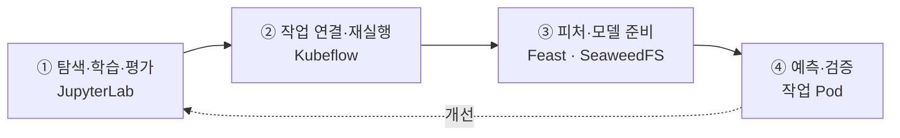
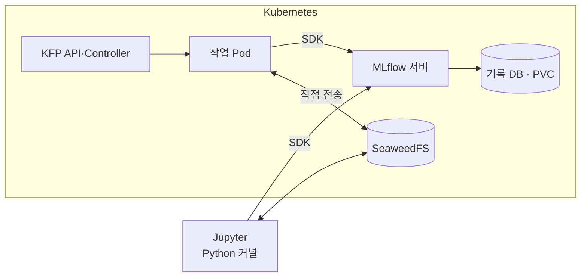
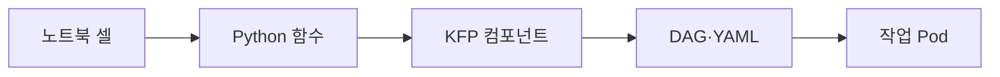
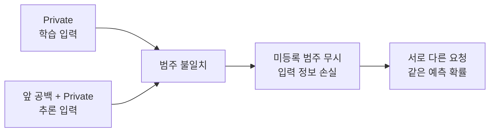
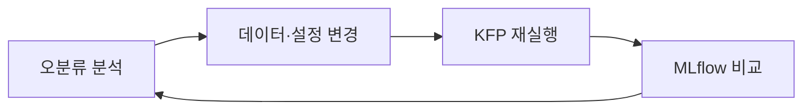

## 한눈에 보기 {#reading-map}

**목표: 학습한 모델과 입력의 출처를 남기고, 같은 절차를 다시 실행하기.** 아래 순서로 읽으면 된다.



| 실행 | 기록·비교 | 파일 보관 |
|---|---|---|
| 노트북 커널 / KFP 작업 Pod | MLflow | SeaweedFS |

## 개요: 모델 개발에서 MLOps까지 {#overview}

『Machine Learning Platform Engineering』의 1~2장은 모델을 만드는 일과 지속적으로 운영하는 일을 연결한다.
3장은 컨테이너·Kubernetes·CI/CD·모니터링이라는 실행 기반을, 4~5장은 실험·피처 관리와 파이프라인을 다룬다.
이번에는 소득 분류 예제로 이 연결을 직접 확인했다.

### ML 개발자는 무엇을 하나

ML 개발자의 일은 **문제를 데이터와 평가 기준으로 바꾸고, 실험을 통해 쓸 만한 모델을 찾는 것**에서 시작한다.
이 글의 예시는 “직업·교육 등의 정보로 소득이 5만 달러를 넘는지 예측할 수 있을까?”다.
개발자는 어떤 열을 입력으로 쓸지, 정답은 무엇인지, 무엇을 좋은 예측으로 볼지 정한다.

데이터가 준비되면 표와 그래프로 분포·결측값·관계를 살펴본다. 이것이 EDA다.
학습·검증·테스트 데이터를 분리하고, 문자열 정리와 범주형 입력의 수치 변환을 적용한다. 변환 규칙은 학습 데이터를 기준으로 정한다.
Decision Tree나 XGBoost 같은 알고리즘을 라이브러리에서 불러와 학습시키고, 점수와 오분류 사례를 확인한다.
좋지 않은 결과가 나오면 데이터·피처·전처리·학습 설정을 바꿔 다시 실험한다.

**JupyterLab은 이 탐색과 실험을 작은 코드 셀로 나눠 확인하는 작업 공간**이다.
예를 들어 CSV를 읽는 셀, 직업별 분포를 그리는 셀, 모델을 학습하는 셀을 각각 실행한다.
개발자는 결과를 보면서 다음 실험을 결정하고, 반복할 절차가 정해지면 코드와 파이프라인으로 정리한다.

### 왜 MLOps가 필요한가

한 번의 실험에서는 노트북과 모델 파일만으로도 진행할 수 있다. 여러 번 반복하면 질문이 달라진다.
**“이 모델은 어떤 데이터로 만들었나?”, “어제보다 점수가 좋아진 이유는 무엇인가?”, “저장한 모델로 같은 예측을 다시 할 수 있나?”**

가령 같은 XGBoost 코드에 데이터를 추가해 다시 학습했다고 하자.
점수가 달라졌다면 데이터가 좋아진 것인지, 분할이나 전처리가 달라진 것인지 구분해야 한다.
`model.pkl`만 덮어쓰면 이전 모델과 비교할 근거가 사라진다.
추론 입력에 공백이 생겨 잘못된 예측이 나오는 경우에는, 학습 코드가 그대로여도 입력 처리부터 조사해야 한다.

**MLOps는 이런 변경을 추적하고, 학습·검증·배포·관측을 반복 가능한 과정으로 만드는 체계**다.
DevOps의 테스트·빌드·배포에 더해 데이터·피처·모델과 예측 품질까지 관리한다.
코드·데이터·설정·모델·실행 결과가 어떻게 이어지는지 남기는 것이 리니지다.

| 실험이 반복될 때의 질문 | 이번 실습에서 확인한 방법 |
|---|---|
| 어떤 설정·데이터로 만든 모델인가? | MLflow의 Run·파라미터·데이터 정보 |
| 어떤 입력과 모델로 예측했나? | 피처 목록·조회 시점·모델 ID·파일 해시 기록 |
| 같은 절차를 다시 실행할 수 있나? | Kubeflow에 작업·입출력·순서를 정의 |

이 기록을 비교해 변경의 효과를 판단하고, 다음 실험을 선택한다.

### MLOps 라이프사이클은 어떻게 반복되나

책의 흐름은 크게 **모델을 찾는 실험 단계**와 **선택한 모델을 배포하고 유지하는 운영 단계**로 볼 수 있다.
새로운 데이터나 잘못된 예측은 다시 데이터 준비와 학습의 계기가 된다. 아래 표는 일반적인 절차이며, 이번 실습의 수행 범위는 표 아래에 구분했다.

| 단계 | 개발자가 하는 일 | 소득 분류에 적용하면 |
|---|---|---|
| 문제 정의 | 목표·평가 기준 정하기 | 소득 구간을 분류하고 어떤 오류를 중시할지 결정 |
| 데이터 준비 | 수집·정리·버전과 정답 확인 | 입력 8개 피처와 소득 레이블 준비 |
| 탐색·학습 | 데이터 이해·전처리·모델 실험 | JupyterLab에서 EDA 후 세 모델 학습 |
| 평가·선택 | 같은 기준으로 후보 비교 | 검증 데이터로 선택, 테스트 데이터로 최종 평가 |
| 배포·추론 | 선택한 모델을 실행 경로에 연결 | 저장한 모델을 읽어 요청한 입력에 배치 예측 |
| 관측·개선 | 오류·입력 변화·품질 저하 분석 | 공백 차이를 발견해 입력 처리 수정, 다음 실험으로 피드백 |

운영 배포 전에는 스테이징에서 후보를 검증하고, 프로덕션에서는 실제 요청과 품질을 관측한다.
자동화도 수동 실험에서 학습 파이프라인 자동화, 파이프라인 자체의 CI/CD로 확장된다.

이번 실습은 **탐색·학습·평가 → 반복 실행 → 배치 추론 → 입력 오류 검증**까지다.
학습·테스트 80:20 분할만 사용한 한계가 있으며, 별도 검증셋·운영 API·모니터링·자동 재학습은 다음 과제다.
이후 본문은 첫 그림의 ①~④ 순서로 이 과정을 따라간다.

## 실행 환경과 역할 {#_2}

| 환경 | 구성 |
|---|---|
| Azure VM | Ubuntu 22.04 · 8 vCPU / 32 GiB · CPU 학습 |
| VM의 Docker | JupyterLab · Redis |
| kind Kubernetes | KFP standalone · MLflow · SeaweedFS · 작업 Pod |



| 도구 | 역할 |
|---|---|
| JupyterLab | 코드를 편집하고 셀 실행. 실제 연산은 커널 |
| MLflow SDK → 서버 | Run·설정·점수·모델 정보 기록 → UI에서 비교 |
| KFP SDK → API·Controller → Pod | DAG 정의 → 실행 제어 → Python 작업 실행 |
| SeaweedFS | 모델·피처·산출물 파일 저장 |

Redis는 노트북의 Feast 온라인 조회에 사용했다. 접속은 SSH 터널, 종료는 VM 할당 해제이며 디스크 비용은 남는다.

## ① 노트북에서 실험하기 {#1-mlflow}

```text
CSV → EDA → 분할 → 전처리 → 학습 → 평가 → 설정 변경
```

| 개발자의 작업 | 이번 실습 |
|---|---|
| 문제 정의 | 직업·교육 등 8개 피처로 소득 >50K 여부 예측 |
| 데이터 탐색 | 30,162행의 표·그래프 확인 |
| 입력 준비 | 학습 80% / 테스트 20%, 원핫 인코딩 |
| 모델 비교 | Decision Tree · Random Forest · XGBoost |
| 기록 | 파라미터·점수·분석 산출물·모델 |

핵심 코드만 발췌했다. `fit()`은 학습, `log_*()`는 기록이다. 셀 출력 전체가 자동 저장되지는 않는다.

```python
with mlflow.start_run(run_name=model_name):
    mlflow.log_param('seed', 42)
    model.fit(X_train, y_train)
    logged = mlflow.sklearn.log_model(model, name='model')
```

같은 테스트 6,033행으로 비교했다. 다수 클래스만 예측하는 기준선 정확도는 약 75.10%이므로 Accuracy와 F1을 함께 봤다.

| 모델 | 테스트 Accuracy | 테스트 ROC-AUC | 테스트 F1 |
|---|---:|---:|---:|
| Decision Tree | 0.8228 | 0.8298 | 0.6103 |
| Random Forest | 0.8276 | 0.8631 | 0.6179 |
| XGBoost | 0.8314 | 0.8818 | 0.6198 |

<figure class="lab-shot" markdown="span">

[](assets/training-comparison.png)

<figcaption>MLflow · 세 모델 비교. 이미지는 클릭하면 원본으로 열린다.</figcaption>
</figure>

`Experiment`는 실험 묶음, `Run`은 개별 실행이다. 모델 선택은 개발자가 한다.
이번에는 테스트 점수로 모델까지 비교했지만, 다음에는 **검증셋으로 선택 → 테스트셋으로 최종 평가**를 분리한다.

## ② 반복 실행으로 옮기기 {#2-kubeflow}



학습은 **준비 → 학습·모델 저장 → 평가 → 비교**로 분리했다. 학습 작업이 모델을 저장하고 평가 작업은 같은 MLflow Run에 점수를 추가한다.
세 모델은 자원 부담을 줄이기 위해 순차 실행했다.

같은 연결 방식을 ③~④의 배치 추론에도 적용했다. 아래는 **뒤에서 실행할 추론 DAG**의 코드이며, 환경·자원 설정은 생략했다.

```python
@dsl.pipeline(name='chapter5-income-batch-inference')
def pipeline(requests_bucket: str, requests_key: str,
             model_uri: str, output_prefix: str = 'predictions'):
    read = read_requests(bucket=requests_bucket, key=requests_key)
    features = retrieve_features(requests=read.outputs['requests'])
    predictions = run_inference(
        features=features.outputs['features'],
        lineage=features.outputs['lineage'], model_uri=model_uri,
        kfp_run_id=dsl.PIPELINE_JOB_ID_PLACEHOLDER,
    )
    write_predictions(
        predictions=predictions.outputs['predictions'],
        bucket=requests_bucket, prefix=output_prefix,
        kfp_run_id=dsl.PIPELINE_JOB_ID_PLACEHOLDER,
    )
```

| 코드 | DAG |
|---|---|
| 컴포넌트 호출 | 파란 작업 노드 |
| `Output` | 노란 산출물 노드 |
| `outputs[...]`를 다음 입력으로 전달 | 의존성 화살표 |

파이프라인 함수는 컴파일 시 그래프를 만든다. 실행 시 핵심 코드는 각 작업 Pod에서 돈다.
재실행은 **Clone run → 파라미터 확인 → Start**. Pod의 기록 코드는 계속 MLflow를 사용한다.

**학습 파이프라인의 비교 리포트**

<figure class="lab-shot" markdown="span">

[](assets/kubeflow-training-report.png)

<figcaption>KFP 산출물 · 세 모델의 평가 결과와 MLflow Run 링크</figcaption>
</figure>

이후 배치 추론에는 이 KFP 학습에서 새로 저장한 **XGBoost의 Logged Model ID**를 지정했다.

## ③ 피처와 모델 준비하기 {#3-feast}

| 대상 | 요청 | 반환 |
|---|---|---|
| Feast 과거 조회 | 사용자 ID + 시점 + 피처 목록 | 해당 시점까지 가장 최근의 유효한 값 |
| Feast 온라인 조회 | 사용자 ID + 피처 목록 | Redis에 적재한 최신 값 |
| MLflow 모델 조회 | Logged Model ID | 모델 정보·저장 위치 |
| SeaweedFS 다운로드 | S3 모델 경로 | 모델 파일 |

책에서 제공한 `user_id`·시점이 포함된 Parquet 3개를 소스로 등록했다.
`Entity`는 조회 대상·키, `FeatureView`는 소스·피처·시점 정의다. 학습은 CSV를 직접 읽었고, 배치 추론에서 Feast를 사용했다.

```python
result = store.get_historical_features(
    entity_df=request_df,  # 사용자 ID·시점 목록
    features=FEATURES,     # 이번에는 8개 피처
).to_df()
```

```python
metadata = MlflowClient().get_logged_model(model_uri[len('models:/'):])
with tempfile.TemporaryDirectory() as temporary:
    directory = mlflow.artifacts.download_artifacts(
        artifact_uri=metadata.artifact_location,  # s3://...
        dst_path=temporary,
    )
    model = mlflow.sklearn.load_model(directory)
```

**모델 파일은 작업 Pod가 SeaweedFS에서 직접 내려받는다.**

<figure class="lab-shot" markdown="span">

[](assets/seaweedfs-model-files.png)

<figcaption>SeaweedFS · model.pkl, MLmodel, 실행 환경 파일</figcaption>
</figure>

**피처 파일과 모델의 학습 출처**

<figure class="lab-shot" markdown="span">

[](assets/seaweedfs-feature-files.png)

<figcaption>원본 Parquet 파일 3개</figcaption>
</figure>

<figure class="lab-shot" markdown="span">

[](assets/mlflow-trained-model.png)

<figcaption>MLflow Source run · 이 모델을 만든 학습 실행</figcaption>
</figure>

## ④ 예측하고 검증하기 {#4}

<figure class="lab-shot" markdown="span">

[](assets/kubeflow-inference.png)

<figcaption>KFP · 요청 읽기 → Feast 조회 → 예측 → 결과 저장</figcaption>
</figure>

| 작업 | 산출물 |
|---|---|
| 요청 읽기 | 사용자 ID·시점 5건: `requests` |
| Feast 조회 | 8개 피처와 재현 정보: `features`, `lineage` |
| 모델 예측 | 예측값: `predictions` |
| 결과 저장 | `predictions.parquet`, 저장 확인 정보, HTML 리포트 |

추론 작업의 상한은 CPU 1개·메모리 2 GiB. 모델 ID·피처 목록·Feast 정의·데이터 해시를 MLflow에 기록했다.
해시는 읽은 파일에서 자동 계산한다. 파일 변경을 구분하기 위한 실습 설계다.

**MLflow 추론 기록과 S3 결과 파일**

<figure class="lab-shot" markdown="span">

[](assets/inference-model-reference.png)

<figcaption>사용한 모델 ID·S3 경로를 추론 Run에 기록</figcaption>
</figure>

<figure class="lab-shot" markdown="span">

[](assets/seaweedfs-prediction-file.png)

<figcaption>Run별 경로의 predictions.parquet</figcaption>
</figure>

### 공백 오류 해결 {#_3}



원본·학습 코드를 대조해 공백 차이를 찾았다. 여러 입력 범주가 `handle_unknown='ignore'`로 무시돼 오류 없이 진행됐다.

```python
X = df[COLUMNS].apply(lambda column: column.str.strip())
labels = model.predict(X)
probabilities = model.predict_proba(X)[:, list(model.classes_).index(1)]
```

| 수정 | 검증 |
|---|---|
| 모델 유지, 추론에 공백 제거 적용 | 5건 모두 원핫 범주 8개 활성화 |
| 정규화한 입력도 MLflow에 저장 | 미등록 범주 수 0 |
| 같은 모델로 별도 계산 | 파이프라인 예측 클래스·확률과 일치 |

<figure class="lab-shot" markdown="span">

[](assets/prediction-result.png)

<figcaption>수정 후 예측 결과 · 책의 공개 예제 데이터</figcaption>
</figure>

별도 정답 대조는 **3/5 일치**였다. 책의 ID 목록과 원본 CSV의 행 순서가 대응한다는 전제로 정답을 연결하고, 입력 8개 피처의 일치도 확인했다.
5건 모두 학습에 포함된 샘플이므로 일반화 성능 평가가 아니며, 이 값은 MLflow에 자동 기록한 정확도도 아니다.

## 결론과 다음 실험 {#_4}

**실행 성공 ≠ 올바른 입력 ≠ 좋은 예측.** 이번에는 출처를 추적하고 같은 절차를 다시 실행할 기반을 만들었다.

| 다음 작업 | 목적 |
|---|---|
| 학습·검증·테스트 분리 | 모델 선택과 최종 평가 구분 |
| 전처리 통합 | 학습·추론 입력 일치 |
| 데이터·피처·파라미터 변경 | MLflow에서 개선 효과 비교 |
| CI/CD·운영 모니터링 | 코드 검사·이미지 빌드·배포, 오류·지연·품질 관측 |



운영 API·모니터링·자동 재학습은 다음 범위다. 책의 GitLab CI·Argo CD·Prometheus·Grafana는 이 확장에 해당한다.
블로그 자동 배포와 ML 파이프라인의 CI/CD는 별개다.

??? note "참고"

    - 책 예제: [4장](https://github.com/practical-mlops/chapter-4), [5장](https://github.com/practical-mlops/chapter-5)
    - [JupyterLab](https://jupyterlab.readthedocs.io/en/stable/user/notebook.html) · [MLflow](https://mlflow.org/docs/latest/ml/tracking/) · [KFP](https://www.kubeflow.org/docs/components/pipelines/overview/)
