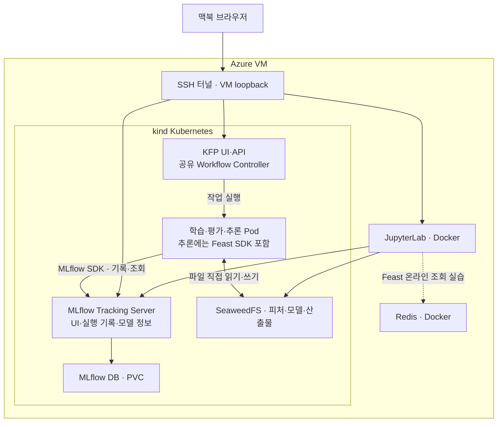
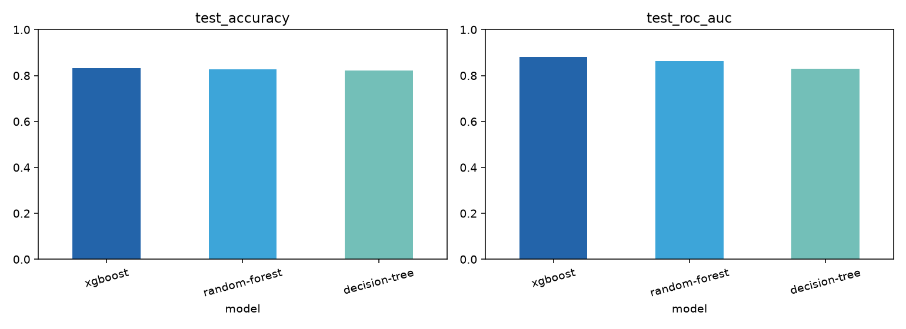
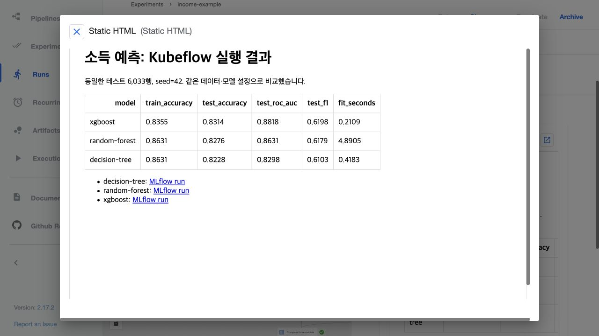
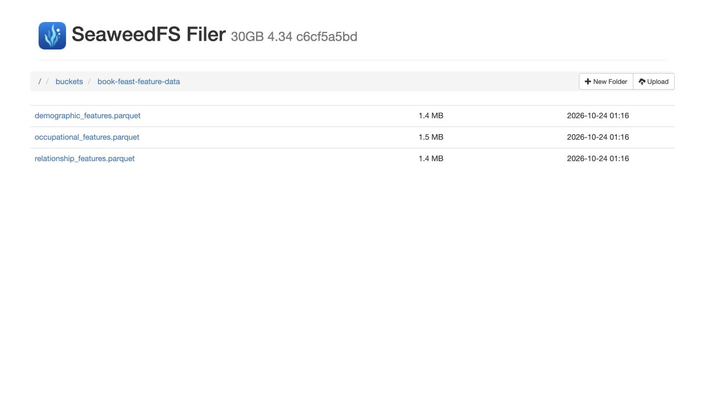
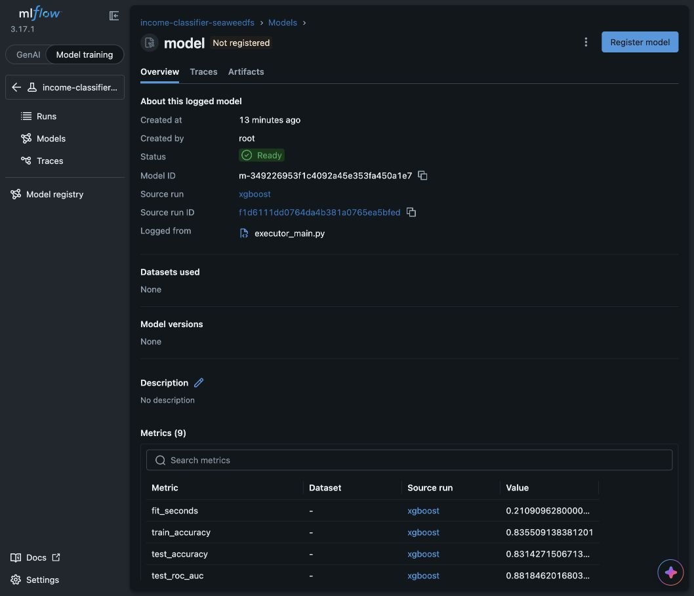
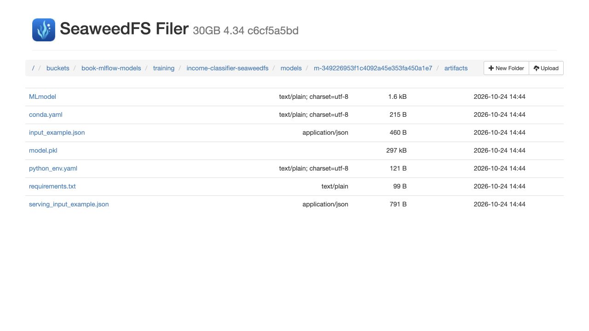
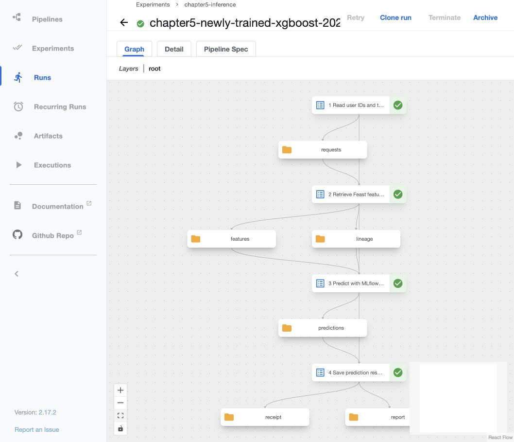
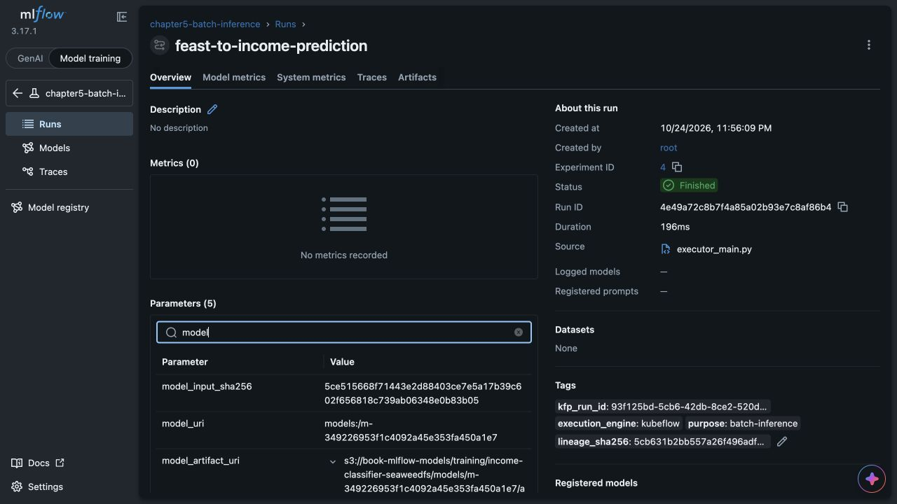
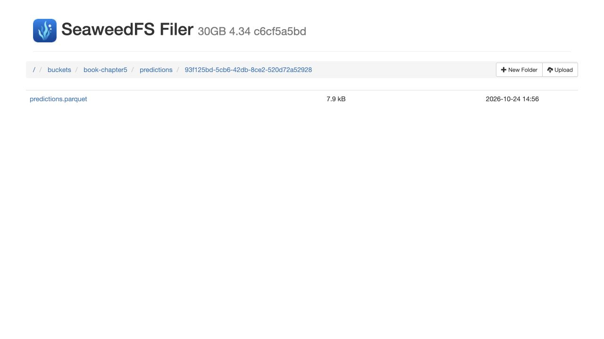
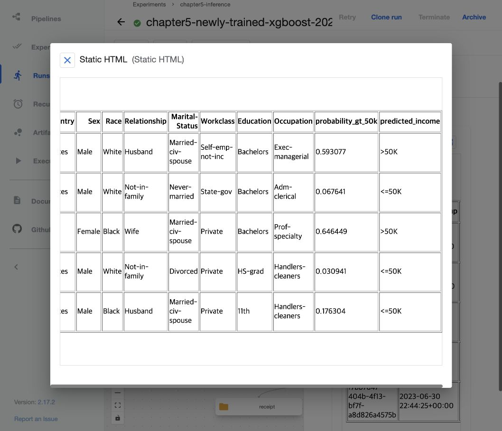

## 왜 이 실습을 했나

『Machine Learning Platform Engineering』을 읽으면서 궁금했던 것은 **“학습한 모델을 어떻게 반복해서 실행하고 운영할까?”**였다.
모델을 한 번 학습하는 것과, 데이터·코드가 바뀌어도 결과를 비교하고 다시 실행할 수 있게 만드는 것은 다른 문제였다.

책 1~5장은 이 흐름의 기반을 설명한다.

| 장 | 핵심 내용 |
|---|---|
| 1. MLOps와 ML 엔지니어링 | 실험에서 운영으로 이어지는 생애주기, 개발자와 플랫폼의 역할 |
| 2. MLOps | DevOps와의 차이, 데이터 변화에 대응하는 반복 과정과 자동화 수준 |
| 3. Kubernetes 기반 | Docker·Kubernetes 실행 기반에 CI/CD와 운영 모니터링을 연결 |
| 4. 실험과 피처 관리 | MLflow로 실험·모델을 기록하고 Feast로 학습·추론용 피처를 관리하는 방법 |
| 5. 파이프라인 오케스트레이션 | 작업과 데이터 전달을 DAG로 정의하고 Kubeflow Pipelines로 배치 추론을 자동화하는 방법 |

이 글에서는 이 개념들을 실제 학습·추론 과정으로 연결해본 경험을 정리한다.

## MLOps와 전체 흐름

**MLOps는 모델 개발과 운영을 연결하고, 데이터·코드·모델의 변경을 추적하며 실행·검증을 반복 가능하게 만드는 방법과 체계다.**
코드가 같아도 학습 데이터가 달라지면 모델이 달라지고, 운영 입력의 변화로 성능이 떨어질 수 있다.
그래서 MLOps는 DevOps의 빌드·배포에 더해 **데이터·모델·실험과 예측 품질**까지 관리한다.

ML 개발자가 수행하는 일을 라이프사이클과 도구로 연결하면 다음과 같다.

| 단계 | 개발자가 하는 일 | 이번 실습의 실행·기록 방식 |
|---|---|---|
| 문제·데이터 준비 | 예측 대상과 평가 기준을 정하고 데이터를 준비 | 소득 분류 목표, 원본 CSV·피처 파일 확인 |
| 탐색·실험 | 표·그래프로 데이터 확인, 전처리와 모델 설정 변경 | JupyterLab에서 셀 실행, MLflow에 분석 산출물 기록 |
| 학습·평가 | 모델을 학습하고 같은 기준으로 비교·선택 | 노트북 또는 KFP 작업 Pod에서 실행, MLflow에 설정·점수·모델 기록 |
| 반복 실행 | 검증한 코드를 작업으로 나누고 입력·순서 고정 | KFP SDK로 DAG 정의, Kubeflow에서 재실행 |
| 배포·추론 | 선택한 모델과 새 입력을 연결해 예측 | Feast 피처 조회 → SeaweedFS 모델 로드 → 배치 추론 |
| 관측·개선 | 오류·데이터 변화·품질 저하를 찾아 개선 | 이번에는 입력 공백 오류까지 확인. 운영 모니터링·자동 재학습은 다음 과제 |

**JupyterLab은 실험하는 작업 공간, MLflow는 실행과 모델의 기록 체계, Kubeflow Pipelines는 작업의 실행 순서와 상태를 관리하는 체계**다.
개발자가 셀을 실행하며 확인한 과정을 파이프라인으로 옮겨도, 학습·평가 로직과 MLflow 기록 코드는 재사용할 수 있다.

실험에서는 유용한 모델을 찾고, 스테이징에서는 배포 후보를 검증하며, 프로덕션에서는 실제 요청을 처리하고 품질을 관측한다.
이번에는 **학습·평가와 배치 추론의 연결**을 확인했다. 운영 API와 스테이징 승격 절차까지 구성한 것은 아니다.

## 환경과 도구의 역할

맥북의 부담을 줄이기 위해 Azure VM 한 대에 구성했다.
Ubuntu 22.04, 8 vCPU·32 GiB 환경에서 GPU 없이 실행했다.



노트북 코드는 VM의 Jupyter 컨테이너 안 Python 커널에서, 파이프라인 코드는 Kubernetes 작업 Pod에서 실행된다.
둘 다 MLflow SDK로 같은 Tracking Server에 기록한다. 서버는 설정·점수·모델 정보를 DB에 보관하고 UI로 보여준다.
**이번 구성의 모델·산출물 파일은 클라이언트가 SeaweedFS에 직접 읽고 쓴다.** MLflow 서버가 학습·추론을 대신 실행하지는 않는다.

Kubeflow에서는 UI·API가 Run을 받고 공유 Workflow Controller와 실행 제어가 DAG를 진행시킨다.
각 작업 Pod가 핵심 Python 함수를 실행하며, 그 코드가 MLflow에 결과를 남긴다.
추론 Pod의 Feast SDK는 과거 피처를 조회하고, Redis는 노트북의 온라인 조회 실습에 사용했다.

Kubernetes 관점에서는 **이미지**가 코드·의존성을 묶고 **Pod**가 실행한다.
**Deployment**는 상시 서비스의 복제본을 유지하고 **Service**는 접속 주소를 제공한다.
**ConfigMap·Secret**은 설정·비밀 전달, **PVC**는 영속 저장, 책에서 소개하는 **Helm**은 여러 리소스의 설치 구성을 묶는 도구다.
전체 Kubeflow가 아닌 Pipelines standalone 구성으로, 실습 후 VM을 할당 해제하고 디스크는 보존했다.

## 1. 노트북에서 학습하고 MLflow로 비교하기

소득 데이터 30,162행에서 직업·교육 등 범주형 피처 8개로 `>50K` 여부를 예측했다.
JupyterLab에서 **CSV 읽기 → EDA → 데이터 분할 → 전처리 → 세 모델 학습·평가**를 셀 단위로 실행했다.
표와 그래프를 보며 입력을 이해하고, 학습 80%·테스트 20% 분할과 원핫 인코딩을 적용했다.

JupyterLab은 코드·설명·출력을 함께 보는 화면이고, 셀의 Python 코드는 커널이 실행한다.
`fit()`은 학습 라이브러리가 실행하며, MLflow 기록은 우리가 넣은 `log_*` 호출이 담당한다.
셀 출력 전체가 저절로 MLflow에 저장되는 것은 아니다. 남길 그래프·표·데이터 정보·모델을 코드에서 지정했다.

학습 코드에서 기록하는 부분은 다음과 같다. 아래 코드들은 실제 구현의 핵심만 발췌했으며, 초기화와 검증 코드는 생략했다.

```python
with mlflow.start_run(run_name=model_name) as run:
    mlflow.log_param('seed', 42)
    model.fit(X_train, y_train)
    logged = mlflow.sklearn.log_model(model, name='model')
```

MLflow의 **Experiment**는 같은 목적의 실험 묶음, **Run**은 개별 실행이다.
노트북에서는 학습·평가·기록을 한 함수로 실행했고, 이후 KFP에서는 학습 작업이 저장한 Run에 평가 작업이 점수를 추가했다.
개발자는 비교 결과를 보고 모델·파라미터를 선택한다. MLflow가 점수를 기록했다고 자동으로 모델을 고르는 것은 아니다.

| 모델 | Accuracy | ROC-AUC | F1 |
|---|---:|---:|---:|
| Decision Tree | 0.8228 | 0.8298 | 0.6103 |
| Random Forest | 0.8276 | 0.8631 | 0.6179 |
| XGBoost | 0.8314 | 0.8818 | 0.6198 |

<figure markdown="span">

[](assets/training-comparison.png)

<figcaption>MLflow에서 같은 데이터로 학습한 세 모델의 지표를 비교했다 · 클릭하면 원본 크기로 볼 수 있다.</figcaption>
</figure>

추론에는 XGBoost를 사용했다. 이번에는 테스트 점수로 모델까지 비교했지만,
실무에서는 모델 선택용 검증 데이터와 최종 평가용 테스트 데이터를 분리해야 한다.

## 2. Kubeflow로 반복 실행하기

탐색 중에는 셀을 바꿔가며 실행하는 방식이 편했다. 반복할 절차가 정해진 뒤에는 준비·학습·평가 코드를 Python 함수로 분리하고 KFP SDK로 연결했다.
개발자는 데이터·모델·평가 기준을 바꾸고, 플랫폼 측에서는 이미지·저장소·권한·실행 자원을 제공한다. 팀에 따라 이 역할을 같은 사람이 맡을 수도 있다.

```text
데이터 준비 → 모델 학습·저장 → 평가 → 세 모델 비교
```

KFP SDK는 이 연결을 YAML로 컴파일하고, 서버는 정의에 따라 작업 Pod를 실행한다.
노트북에서 사람이 다음 셀을 눌렀던 실행 순서가 작업 간 의존성으로 바뀐 것이다. 자원 부담을 줄이기 위해 세 모델은 순차 실행했다.

UI에서는 **Clone run → 파라미터 확인 → Start**로 다시 실행하고,
그래프에서 진행 상태와 로그·산출물을 확인했다.

**한 번의 학습·추론 실행 안에서 Kubeflow와 MLflow가 함께 사용된다. Kubeflow가 MLflow 기록을 읽어서 자동으로 학습을 개선하는 구조는 아니다.**

<figure markdown="span">

[](assets/kubeflow-training-report.png)

<figcaption>Kubeflow 학습 작업이 만든 비교 리포트. 각 모델의 MLflow Run으로 연결된다 · 클릭하면 원본 크기로 볼 수 있다.</figcaption>
</figure>

### Python 코드가 DAG로 연결되는 지점

핵심 함수를 `@dsl.component`로 감싼 뒤, 파이프라인 함수에서 그 결과를 다음 작업의 입력으로 넘겼다.
아래는 **뒤에서 실행할 4단계 추론 파이프라인**의 연결 코드다. 자원·환경 설정은 생략했다.

```python
@dsl.pipeline(name='chapter5-income-batch-inference')
def pipeline(requests_bucket: str, requests_key: str,
             model_uri: str, output_prefix: str = 'predictions'):
    read = read_requests(bucket=requests_bucket, key=requests_key)
    features = retrieve_features(requests=read.outputs['requests'])
    predictions = run_inference(
        features=features.outputs['features'],
        lineage=features.outputs['lineage'], model_uri=model_uri,
        kfp_run_id=dsl.PIPELINE_JOB_ID_PLACEHOLDER,
    )
    write_predictions(
        predictions=predictions.outputs['predictions'],
        bucket=requests_bucket, prefix=output_prefix,
        kfp_run_id=dsl.PIPELINE_JOB_ID_PLACEHOLDER,
    )
```

| 코드 | UI의 DAG에서 보이는 것 |
|---|---|
| `read_requests(...)` 등 컴포넌트 호출 | 파란 작업 노드 |
| 컴포넌트가 `Output`으로 선언한 `requests` 등 | 노란 산출물 노드 |
| `read.outputs['requests']`를 다음 입력으로 전달 | 선행 작업의 결과를 기다리는 화살표 |

이 함수는 **컴파일할 때 그래프를 구성**한다. 실행 시에는 Kubeflow가 각 작업 Pod에서 핵심 함수를 호출한다.
파이프라인 함수 자체가 별도의 학습·추론 Pod로 실행되는 구조는 아니다.

## 3. Feast로 추론 입력 가져오기

책의 예제는 사용자 ID가 붙은 Parquet 파일 3개에 피처를 나눠 저장해두었다.
Feast에 조회 키인 **Entity**와 데이터 소스·피처·시점 열을 설명하는 **FeatureView**를 등록했다.

이후에는 파일 대신 **사용자 ID·조회 시점·피처 이름**을 지정했다.
Feast가 그 시점보다 늦지 않은 가장 최근의 유효한 값을 찾아 표로 돌려준다.
별도로 최신 피처를 Redis에 적재해 ID로 빠르게 가져오는 온라인 조회도 실행했다.

이번 학습은 CSV를 직접 읽었고, 다음 배치 추론에서 Feast의 과거 시점 조회를 사용했다.

<figure markdown="span">

[](assets/seaweedfs-feature-files.png)

<figcaption>SeaweedFS Filer에서 확인한 원본 피처 파일 3개 · 클릭하면 원본 크기로 볼 수 있다.</figcaption>
</figure>

조회 코드는 사용자·시점 목록과 요청할 피처 목록을 전달하는 형태다. 실제 배치 추론에서는 8개 피처를 요청했다.

```python
request_df = pd.read_parquet(requests)
result = store.get_historical_features(
    entity_df=request_df,
    features=FEATURES,
).to_df()
```

## 4. 저장한 모델로 배치 추론하기

모델은 SeaweedFS에 저장하고, 추론 Pod가 직접 내려받도록 구성했다.
MLflow에서는 사용할 모델의 ID와 저장 위치를 확인한다.

<figure markdown="span">

[](assets/mlflow-trained-model.png)

<figcaption>MLflow 모델 페이지의 Source run에서 이 모델을 만든 XGBoost 학습 실행을 확인할 수 있다 · 클릭하면 원본 크기로 볼 수 있다.</figcaption>
</figure>

<figure markdown="span">

[](assets/seaweedfs-model-files.png)

<figcaption>동일 모델 ID의 실제 파일. model.pkl과 MLmodel·환경 정의가 SeaweedFS에 저장됐다 · 클릭하면 원본 크기로 볼 수 있다.</figcaption>
</figure>

다운로드는 MLflow SDK를 사용하되, `s3://` 위치를 직접 전달해 모델 파일이 MLflow HTTP 프록시를 거치지 않도록 했다.

```python
metadata = MlflowClient().get_logged_model(model_uri[len('models:/'):])
location = metadata.artifact_location  # s3://.../artifacts
with tempfile.TemporaryDirectory() as temporary:
    directory = mlflow.artifacts.download_artifacts(
        artifact_uri=location, dst_path=temporary,
    )
    model = mlflow.sklearn.load_model(directory)
```

<figure markdown="span">

[](assets/kubeflow-inference.png)

<figcaption>최종 추론 Run. 네 작업의 성공 상태와 requests·features·lineage·predictions 산출물이 보인다 · 클릭하면 원본 크기로 볼 수 있다.</figcaption>
</figure>

추론 작업마다 CPU 최대 1개·메모리 최대 2 GiB로 제한했다. 실제 입출력은 다음과 같다.

| 단계 | 워크로드와 산출물 |
|---|---|
| 요청 읽기 | 사용자 ID·시점 5건 → `requests` |
| Feast 조회 | 요청별 입력 피처 8개와 재현 정보 → `features`, `lineage` |
| 모델 예측 | 새로 학습한 XGBoost로 5건 예측 → `predictions` |
| 결과 저장 | `predictions.parquet` 저장, 저장 확인 정보와 HTML 표 → `receipt`, `report` |

재현하려면 사용자와 시점뿐 아니라 **요청한 피처 목록, Feast 정의, 데이터와 모델의 버전**도 필요했다.
이 정보와 실제 읽은 파일의 해시를 MLflow에 함께 기록했다.
해시는 수동 입력 대신 자동 계산하도록 바꿨다. MLflow의 필수 요구사항이 아니라,
같은 경로의 파일이 바뀌었는지 구분하기 위한 선택이었다.

<figure markdown="span">

[](assets/inference-model-reference.png)

<figcaption>추론 MLflow Run에 남긴 모델 ID·실제 S3 경로·직접 다운로드 방식 · 클릭하면 원본 크기로 볼 수 있다.</figcaption>
</figure>

<figure markdown="span">

[](assets/seaweedfs-prediction-file.png)

<figcaption>SeaweedFS에 Run별 경로로 저장한 최종 predictions.parquet · 클릭하면 원본 크기로 볼 수 있다.</figcaption>
</figure>

## 겪었던 문제: 성공했는데 예측이 이상하다

파이프라인은 성공했지만 서로 다른 다섯 요청의 예측 확률이 모두 같았다.
입력을 원본·학습 코드와 대조하니 **학습에서는 공백을 제거했지만 Feast에서 가져온 값에는 앞 공백이 남아 있었다.**
예를 들어 `'Private'`와 `' Private'`는 인코더에 서로 다른 범주다.
`OneHotEncoder(handle_unknown='ignore')`가 모르는 범주를 오류 없이 무시하면서 입력 정보가 사라졌다.

추론에서도 학습과 같은 공백 제거를 적용했다. 모델은 다시 학습하지 않았다.

```python
X = df[COLUMNS].apply(lambda column: column.str.strip())
labels = model.predict(X)
probabilities = model.predict_proba(X)[:, list(model.classes_).index(1)]
```

수정 후에는 확률이 달라졌다는 사실에 더해 다음을 확인했다.

| 확인한 근거 | 결과 |
|---|---|
| 원핫 인코딩 결과 | 5건 모두 행마다 8개 피처의 범주가 하나씩 활성화됨 |
| 모르는 범주 수 | `unknown_category_values = 0`을 MLflow에 기록 |
| 같은 모델로 별도 계산 | 파이프라인의 예측 클래스·확률과 일치 |

정규화한 입력도 MLflow에 남겨 재확인할 수 있게 했다.

<figure markdown="span">

[](assets/prediction-result.png)

<figcaption>최종 HTML 리포트의 예측 결과. 성별·직업·소득 구간은 책의 공개 예제 데이터이며 작성자나 회사 고객의 정보가 아니다. 클릭하면 원본 크기로 볼 수 있다.</figcaption>
</figure>

별도로 원본 행과 연결해 정답을 대조했을 때는 5건 중 3건이 맞았다.
학습에 포함된 소수 샘플이므로 일반화 성능 평가는 아니다.
**실행 성공, 입력·계산의 정확성, 예측 성능은 각각 확인해야 했다.**

## 결론과 개선점

이번 실습에서는 **학습 실행 → 저장한 모델 → 추론 입력 → 예측 결과**를 연결했다.
MLflow로 실행과 모델의 출처를 기록하고, Feast로 입력 피처를 조회하고,
Kubeflow로 같은 흐름을 반복 실행할 수 있게 만들었다.

하지만 파이프라인이 정상적으로 끝나는 것과 모델이 좋은 예측을 하는 것은 별개였다.
다섯 건 중 두 건은 틀렸고, 공백 처리 차이만으로도 입력이 달라졌다.
이 다섯 건만으로 전체 성능을 판단할 수는 없지만, **이제는 실행 환경을 만드는 데서 나아가 예측 품질을 개선할 차례**다.

우선 다음을 보완하려 한다.

- **평가 기준 정리**: 학습·검증·테스트 데이터를 분리하고, 정확도뿐 아니라 F1·정밀도·재현율과 오분류 사례를 함께 본다.
- **전처리 일관성 확보**: 문자열 공백 처리까지 모델의 전처리 과정에 포함해 학습과 추론에서 같은 변환을 사용한다.
- **데이터와 모델 개선**: 누락된 유용한 피처, 데이터 품질, 추가 데이터의 효과를 살펴보고 모델과 하이퍼파라미터를 바꿔 비교한다.

## 다음 단계: MLOps로 개선을 반복하기

실험 추적과 파이프라인 실행을 연결한 다음에는 운영으로 이어지는 자동화가 필요하다.

| 보완할 영역 | 다음에 연결할 내용 |
|---|---|
| CI | 코드 변경 시 테스트 → 이미지 빌드 → 코드·이미지 버전 연결. 책에서는 GitLab CI를 다룬다 |
| CD·GitOps | 검증한 파이프라인·서비스 배포 설정 반영과 복구. 책에서는 Argo CD를 다룬다 |
| 모니터링 | Prometheus·Grafana로 오류·지연·자원 관측, 별도로 입력 변화와 예측 품질 확인 |

자동화 수준은 수동 실행에서 학습 파이프라인 자동화, 파이프라인 자체의 빌드·배포 자동화로 확장된다.
현재는 파이프라인을 직접 제출·재실행하는 단계이며, **블로그의 GitHub Actions 배포와 ML 워크로드의 CI/CD는 별개**다.
다음 실험에서는 아래 흐름으로 품질 개선 효과부터 비교할 계획이다.

```text
오분류 분석 → 데이터·전처리·학습 설정 변경 → Kubeflow 재실행
    → MLflow에서 기존 결과와 비교 → 후보 모델 선택 → 테스트·추론 검증
```

각 실험에 사용한 데이터·코드·피처·모델의 출처를 남기고, 같은 평가 기준으로 이전 결과와 비교한다.
검증 데이터에서 나아진 후보를 선택한 뒤, 별도로 남겨둔 테스트 데이터에서 최종 성능을 확인할 것이다.

**MLOps가 예측 성능을 저절로 높여주지는 않는다. 개선을 시도하고, 효과를 검증하고, 그 과정을 다시 실행할 수 있게 해준다.**
이번에는 그 기반을 만들었다면, 다음에는 이를 이용해 부족한 예측 결과를 실제로 개선해보려 한다.

---

- 책 예제: [4장](https://github.com/practical-mlops/chapter-4), [5장](https://github.com/practical-mlops/chapter-5)

- 도구 문서: [JupyterLab 노트북](https://jupyterlab.readthedocs.io/en/stable/user/notebook.html), [MLflow Tracking](https://mlflow.org/docs/latest/ml/tracking/), [Kubeflow Pipelines](https://www.kubeflow.org/docs/components/pipelines/overview/)
