앞선 실습에서는 모델을 학습하고, API로 배포하고, 운영 데이터를 다시 학습에 반영하는 흐름을 연결했다. 이번에는 그중 **학습·검증 단계 안에서 데이터를 어떻게 나누고, 작업을 연결하고, 모델을 선택할지**를 다룬다.

| 글 | 초점 | 확인한 흐름 |
|---|---|---|
| [1편](azure-mlops-lab.md) | 학습부터 추론까지 연결 | 노트북 실험 → 학습 기록 → 파이프라인 실행·추론 |
| [2편](model-serving-monitoring.md) | 모델을 서비스로 운영 | API 배포 → 운영 데이터 수집·분석 → 재학습 |
| **3편** | **학습·검증 파이프라인 구성** | **데이터 분리·검사 → 작업 간 파일 공유 → 검증·모델 선택** |

예를 들어, 같은 영상에서 뽑은 비슷한 사진이 학습과 검증에 섞이면 점수를 믿기 어렵다. 학습 Pod가 만든 모델을 다른 Pod에서 검증하려면 파일을 전달할 방법도 필요하다. 새 모델의 학습이 끝났다고 기존 모델을 바로 교체할 수도 없다.

책 7~9장의 신분증 검출·영화 추천 예제로 이 문제들을 하나씩 확인했다. **촬영 시퀀스별 데이터 분리, Artifact와 PVC의 파일 공유 방식, Harbor 이미지 버전 고정, 검증 점수에 따른 모델 등록**이 이번 글의 핵심이다.

## 데이터에서 모델까지

| 단계 | 하는 일 | 결과 |
|---|---|---|
| [1. 데이터 준비](#data) | 원본 확인, 학습·검증·테스트 분리, 파일 검사 | 재사용할 데이터셋 |
| [2. 실행 환경 준비](#images) | 코드·라이브러리 이미지 빌드, Harbor 보관 | 실행할 이미지 버전 |
| [3. 학습·검증](#training) | YOLO 학습 후 저장 모델을 별도 Pod에서 검증 | 모델·검증 점수 |
| [4. 데이터 공유](#volume) | 같은 학습을 공유 볼륨으로 실행 | PVC·Artifact 방식 비교 |
| [5. 모델 등록](#registry) | 영화 추천 모델 학습, 기존 모델과 비교·선택 | MLflow 모델 버전 |

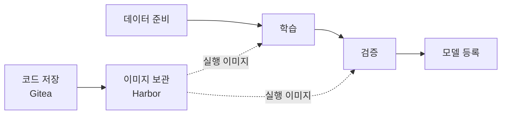

작업은 기존 Azure VM의 kind 클러스터에서 CPU로 실행했다. 데이터와 모델 파일은 SeaweedFS에 보관한다.

| 예제 | 확인할 질문 | 기록 위치 |
|---|---|---|
| 신분증 검출 | 사진에서 신분증이 어디에 있는가? | KFP 산출물·검증 지표, TensorBoard |
| 영화 추천 | 이 사용자가 이 영화에 몇 점을 줄까? | MLflow 학습 기록·등록 모델 |

데이터 준비도 이번에는 Kubeflow로 구성했다. 2편의 Airflow 실습은 코드와 이력을 보관하고 서버를 중지했다. 이번 두 예제는 준비한 파일을 직접 읽으므로 Feast 등록 단계는 없다.

## 1. 데이터 준비 {#data}

7장에서는 Kubeflow Notebooks로 JupyterLab을 띄웠다. Python 커널은 Notebook Pod 안에서 실행되고, 노트북 파일은 PVC에 남는다. 노트북에서 파이프라인을 제출하면 각 작업은 별도의 Pod에서 실행된다.

| 데이터 | 준비한 내용 | 확인 항목 |
|---|---|---|
| MIDV-500 일부 | 이미지·라벨 12쌍 → 학습·검증·테스트 각 4쌍 | 파일 짝, 박스 좌표, 해시, 촬영 시퀀스 혼입 |
| MovieLens small | 평점 100,836건 → 학습 75,627 / 검증 15,125 / 테스트 10,084 | 스키마, 행 수, 중복·누락, 영화 ID 참조 |

신분증은 같은 영상의 비슷한 프레임이 학습과 검증에 동시에 들어가지 않도록 **촬영 시퀀스로 분리**했다. 영화 데이터는 평점 세트 세 개와 영화 목록 한 개, 총 네 Parquet 파일로 저장했다.

<figure class="lab-shot" markdown="span">

[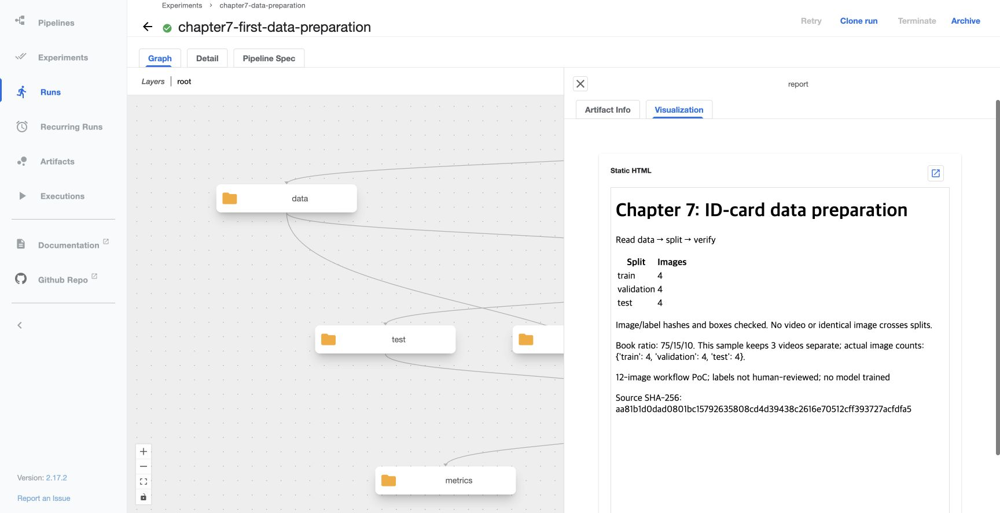](assets/data-training-registry/id-card-preparation.jpg)

<figcaption>7장 데이터 준비 결과. 학습·검증·테스트 4장씩 나누고 파일과 라벨을 검사했다. 이 화면은 학습 전 단계다.</figcaption>
</figure>

<figure class="lab-shot" markdown="span">

[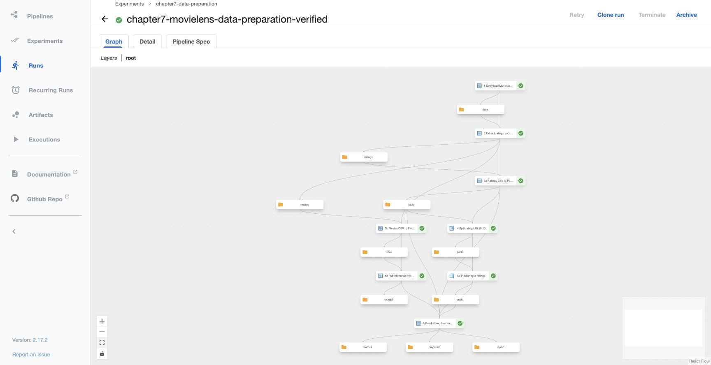](assets/data-training-registry/movielens-preparation.png)

<figcaption>MovieLens 다운로드 → Parquet 변환·분리 → SeaweedFS 저장 → 저장된 파일 재검사. 마지막 prepared 산출물의 URI를 학습 파이프라인에 전달한다.</figcaption>
</figure>

`prepared_uri`는 **검사한 데이터 묶음의 위치**다. 학습 단계에서는 여기에 기록된 파일 위치와 해시를 확인하고 데이터를 읽는다. 같은 입력을 다시 선택할 수 있도록 준비와 학습을 분리했다.

## 2. 실행 환경 준비 {#images}

| 저장소 | 저장 대상 |
|---|---|
| Gitea | Python 코드, Dockerfile, 파이프라인 정의, 테스트 |
| Harbor | 코드와 라이브러리를 묶은 컨테이너 이미지 |
| SeaweedFS | 데이터, 모델 파일, 실행 산출물 |
| MLflow | 영화 모델의 학습 설정·점수·모델 연결 정보와 등록 버전 |

기존 작업용 파이프라인 18개에 Harbor 이미지를 사용하는 버전을 등록했다. 예측 API와 실습 Notebook 이미지도 옮겼다. Kubeflow·MLflow 등 플랫폼 자체의 이미지는 유지했다.

2편에서 사용한 Gitea 이미지 레지스트리에서 Harbor로 옮겼다. 이미지 태그가 바뀌어도 실행 대상을 식별할 수 있도록 파이프라인에는 **digest로 고정한 이미지**를 사용했다.

<figure class="lab-shot" markdown="span">

[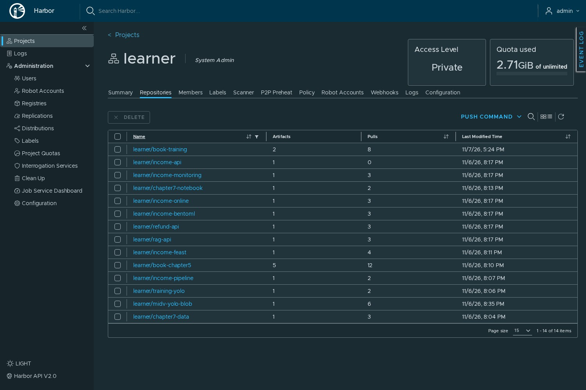](assets/data-training-registry/harbor-repositories.jpg)

<figcaption>Harbor의 learner 프로젝트. book-training은 이번 학습 이미지이며, Notebook·예측 API 이미지도 같은 저장소에서 관리한다.</figcaption>
</figure>

<figure class="lab-shot" markdown="span">

[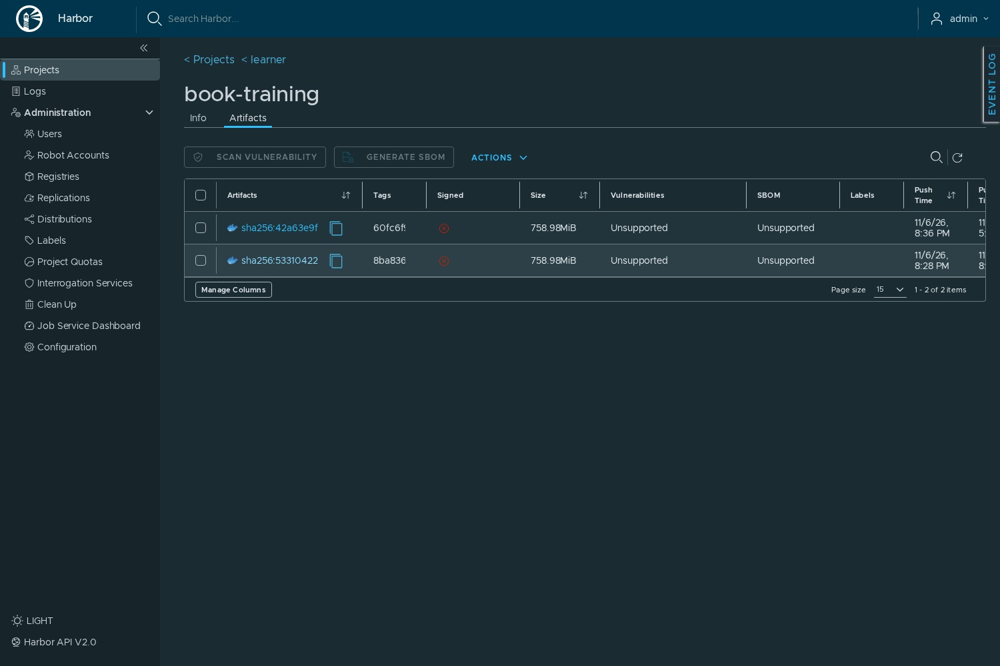](assets/data-training-registry/harbor-training-image.jpg)

<figcaption>book-training 이미지의 두 버전. 수정한 이미지의 digest는 42a63e9f…로 시작하며, 최종 성공 Run들이 이 이미지를 사용했다.</figcaption>
</figure>

## 3. YOLO 학습·검증 {#training}

8장은 `chapter8-yolo-artifacts` 파이프라인이다. 데이터 준비 결과를 읽고 YOLOv8n을 파인튜닝한 다음, 다른 Pod에서 저장된 `best.pt`를 열어 검증한다.

실제 파이프라인의 연결 부분이다. `workload()`는 각 Task에 자원 제한과 이미지 접근 설정 등을 적용하는 보조 함수다.

```python
@dsl.pipeline(name='chapter8-yolo-artifacts')
def chapter8(prepared_uri: str, epochs: int = 1):
    data = workload(
        load_cards(uri=prepared_uri),
        storage=True,
    )
    fit = workload(train_cards(
        dataset=data.outputs['dataset'],
        epochs=epochs,
    ))
    workload(validate_cards(
        dataset=data.outputs['dataset'],
        model=fit.outputs['model'],
    ))
```

`train_cards`는 이미지 안의 `python -m book_training.train_cards`를 실행한다. 학습 코드는 지정된 출력 경로에 모델을 쓰고, KFP가 그 파일을 산출물로 보관한다. 그래프의 노란 폴더는 이렇게 선언한 `Dataset`, `Model`, `Artifact`다.

<figure class="lab-shot" markdown="span">

[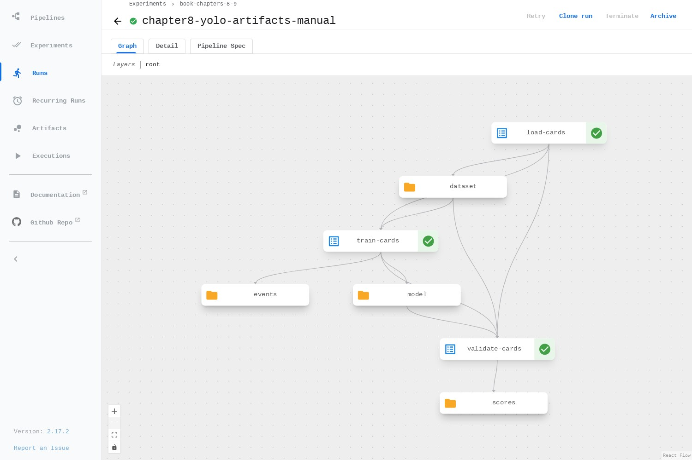](assets/data-training-registry/yolo-artifacts.jpg)

<figcaption>load-cards → train-cards → validate-cards. 코드의 outputs 연결이 dataset·model 산출물과 화살표로 나타난다.</figcaption>
</figure>

## 4. 같은 데이터를 PVC로 공유하기 {#volume}

9장에서는 같은 학습을 `chapter9-yolo-pvc`로 실행했다.

| 방식 | Task 사이의 데이터 전달 | 실행 후 보관 |
|---|---|---|
| 8장 Artifact | 저장소에 보관된 산출물을 다음 Pod로 전달 | 데이터·모델·로그 |
| 9장 PVC | Run 전용 볼륨에 한 번 복사하고 학습·검증 Pod가 공유 | 모델·로그를 산출물로 복사한 뒤 PVC 삭제 |

<figure class="lab-shot" markdown="span">

[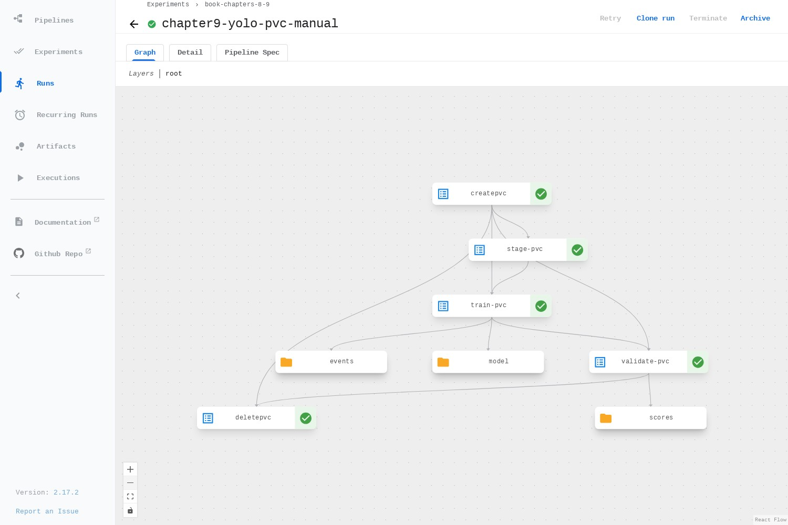](assets/data-training-registry/yolo-pvc.jpg)

<figcaption>createpvc로 만든 볼륨을 stage-pvc·train-pvc·validate-pvc가 공유한다. 모델·로그를 보관하고 검증을 마치면 deletepvc로 정리한다.</figcaption>
</figure>

두 방식 모두 약 6.45MB의 `best.pt`와 TensorBoard 이벤트 파일이 저장됐다. 보관한 이벤트로 TensorBoard를 다시 열어 손실·검증 지표 10개를 읽는 것까지 확인했다. 이번 실행은 1에포크라 학습 추세를 판단하기에는 부족하다.

<figure class="lab-shot" markdown="span">

[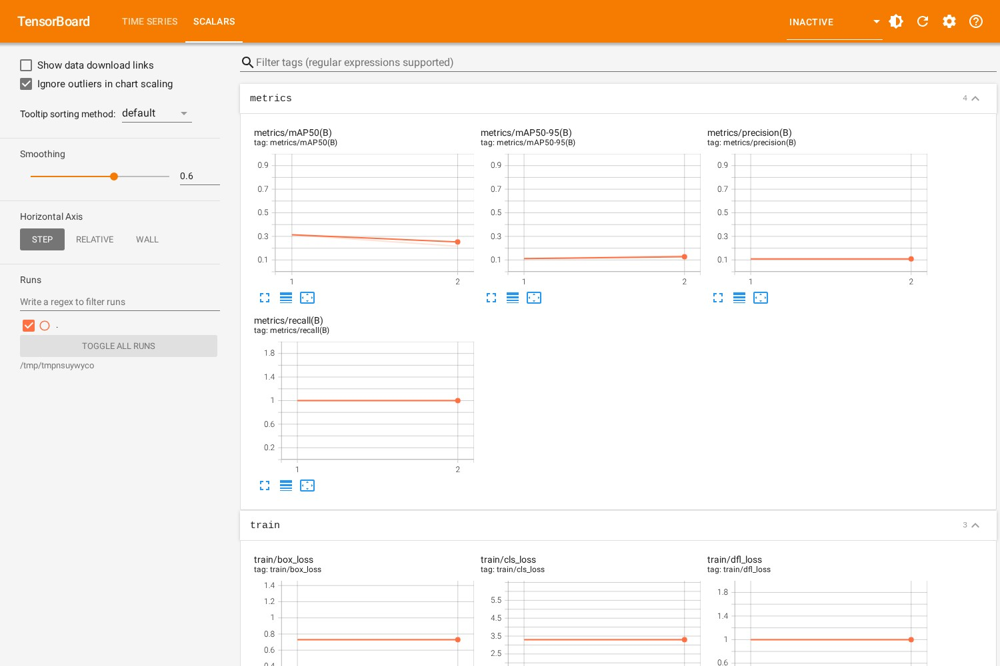](assets/data-training-registry/tensorboard.jpg)

<figcaption>train-pvc의 events 산출물을 다시 연 TensorBoard. 학습 손실과 검증 지표를 함께 확인한다.</figcaption>
</figure>

## 5. 영화 추천 모델 등록 {#registry}

`chapter9-movielens-training`은 **사용자와 영화 ID를 받아 평점을 예측하는 모델**이다. 사용자·영화 임베딩을 학습하고, MLflow에 저장한 모델을 다시 불러와 검증했다.

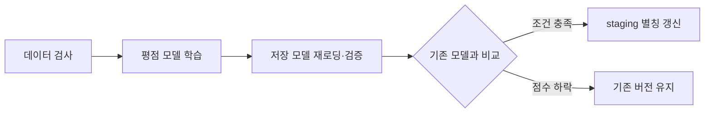

<figure class="lab-shot" markdown="span">

[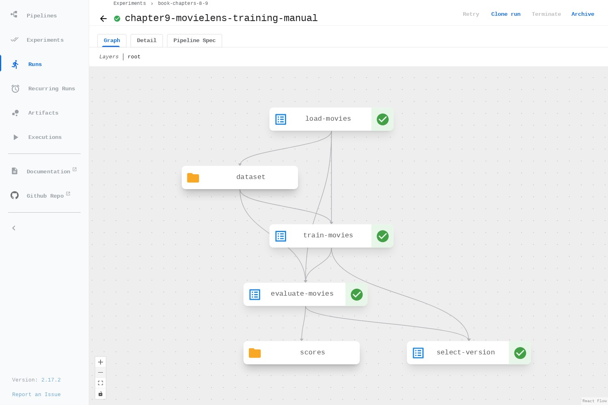](assets/data-training-registry/movie-training.jpg)

<figcaption>load-movies → train-movies → evaluate-movies → select-version. 학습한 모델을 다시 불러와 평가하고 등록할 버전을 선택한다.</figcaption>
</figure>

학습에는 사용자별로 평가하지 않은 영화 중 최대 10편을 골라 0점 예시로 추가했다. 이 값은 실제 평점이 아닌 학습용 가정이다. 학습에 없던 사용자나 영화는 학습 데이터의 평균 평점으로 처리했다.

| 비교 조건 | 처리 |
|---|---|
| 등록된 기준 모델 없음 | 첫 후보 등록 |
| 같은 데이터 버전·K, RMSE 증가 없음, Precision·Recall 하락 없음 | 후보 등록, `staging` 갱신 |
| 지표 중 하나라도 악화 | 기존 버전 유지 |
| 데이터 버전·K가 달라 직접 비교 불가 | 검토 대상으로 남김 |

`staging`은 **다음에 사용할 모델을 가리키는 별칭**이다. 이 단계에서 예측 API를 배포한 것은 아니다.

<figure class="lab-shot" markdown="span">

[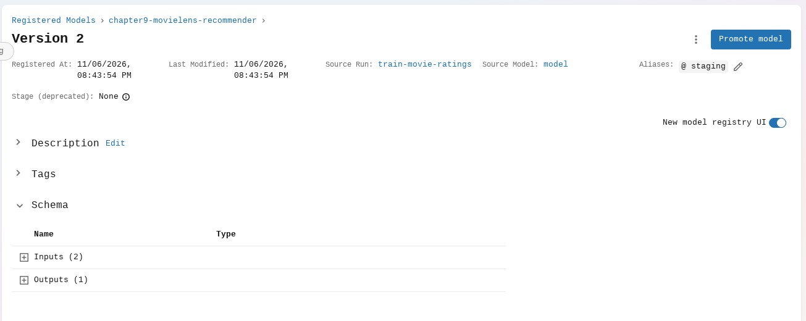](assets/data-training-registry/mlflow-version.jpg)

<figcaption>Version 2의 Source Run은 train-movie-ratings, 별칭은 staging이다. 이 링크로 해당 모델의 학습 설정과 점수를 확인할 수 있다.</figcaption>
</figure>

## 실행 결과

| 파이프라인 | 결과 | 확인한 산출물 |
|---|---|---|
| `chapter8-yolo-artifacts` | 성공 | YOLO 모델·검증 지표·이벤트 로그 |
| `chapter9-yolo-pvc` | 수정 후 성공 | 모델·로그 보관, 공유 볼륨 정리 |
| `chapter9-movielens-training` | 성공 | MLflow 모델 버전 2·검증 지표·재로딩 예측 |

영화 모델은 2에포크로 실행했다.

<figure class="lab-shot" markdown="span">

[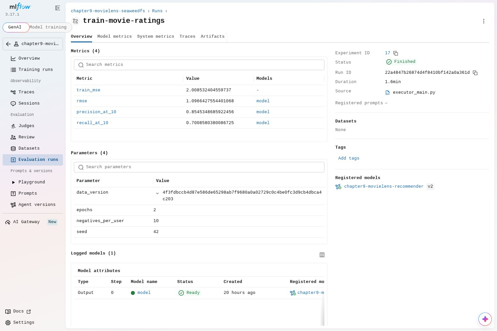](assets/data-training-registry/mlflow-metrics.jpg)

<figcaption>같은 Run에 RMSE·Precision·Recall, 데이터 버전, epochs·seed를 기록했다. 오른쪽 Registered models에서 등록 버전으로 이동할 수 있다.</figcaption>
</figure>

| 검증 지표 | 값 | 의미 |
|---|---:|---|
| RMSE | 1.0966 | 예측 평점의 오차. 낮을수록 좋음 |
| Precision@10 | 0.8545 | 상위 최대 10개 후보 중 선호 영화의 비율 |
| Recall@10 | 0.7009 | 선호 영화 중 상위 최대 10개에 포함된 비율 |

순위 지표는 **사용자별 검증 데이터에 있는 영화 후보 안에서** 계산했다. 선호 기준은 실제 평점 3점 이상이며 사용자별 점수를 평균했다. 전체 영화 목록을 대상으로 한 추천 성능과는 평가 조건이 다르다. 테스트 세트는 이번 모델 선택에 사용하지 않았다.

등록 모델을 다시 불러와 사용자 1에 대해 예측한 결과다. 모델 버전은 등록 순서이며, 성능 변화는 검증 지표로 판단한다.

| 영화 ID | 예측 평점 |
|---|---:|
| 50 | 4.468 |
| 260 | 3.991 |
| 1 | 3.918 |

## 막혔던 부분

### 공유 데이터에 생긴 YOLO 캐시

**첫 실행에서는 학습 뒤 검증이 실패했다.** YOLO가 공유 데이터 경로에 `train.cache`, `val.cache`를 만들었고, 다음 Task의 파일 목록 검사에서 준비된 원본과 달라졌다고 판단했다.

| 문제 | 수정 | 확인 |
|---|---|---|
| 학습 도구가 원본 폴더에 캐시 생성 | Task별 임시 폴더에 원본 파일 링크를 만들고 그곳에서 YOLO 실행 | 원본 파일 목록·해시 유지, 재실행 성공 |

이미지와 라벨은 같은 PVC의 파일을 읽는다. 캐시만 Task의 임시 폴더에 남도록 바꿨다. 검증에 성공하면 PVC를 삭제하고, 실패한 Run의 볼륨은 원인 확인 후 정리했다.

### Harbor 인증서 반영

Harbor 연결에는 실습 환경의 제약이 있었다. 실행 중인 kind의 containerd가 새 인증서를 바로 반영하지 않아, 게시 도구가 Harbor에서 해당 digest의 이미지를 인증 후 노드에 미리 받아두도록 했다. 따라서 이번 확인 범위는 **미리 받은 이미지로 작업이 실행되는 것까지**다. 새 노드에서의 최초 pull은 별도 확인이 필요하다.

## 마무리

이번에는 **준비한 데이터를 다음 Run의 입력으로 선택하고, 학습한 모델을 다시 열어 검증한 뒤 등록하는 과정**을 끝까지 실행했다. 공유 볼륨에서는 학습 도구가 만드는 캐시까지 고려해야 한다는 점도 확인했다.

신분증은 12장·1에포크의 동작 확인이고, 영화 추천도 소형 데이터와 제한된 후보로 검증했다. 다음 개선은 데이터와 학습량을 늘리고, 추천 후보 구성과 비교 기준을 정한 뒤, 선택한 모델을 남겨둔 테스트 세트로 평가하는 것이다.

책 예제는 CPU 환경에 맞게 조정했다. 신분증은 7장에서 확정한 분할을 재사용했고, MovieLens는 25M 대신 small을 사용했다.

참고 코드: [8장 YOLO](https://github.com/practical-mlops/object-detection-project/blob/c6afb114e628e776a76f9ac50b45899aff5e8eaf/training_and_validation_pipeline.py) · [9장 공유 PVC](https://github.com/practical-mlops/object-detection-project/blob/c6afb114e628e776a76f9ac50b45899aff5e8eaf/pipeline_with_pvc.py) · [9장 영화 추천](https://github.com/practical-mlops/movie-recommender-project/blob/4e0a808e0dca3aef16850cd14df47d2fda9f9bd2/02_training_and_validation.py)
