지난 [첫 번째 실습](azure-mlops-lab.md)에서는 소득 분류 모델을 학습하고, 저장한 모델로 배치 추론을 실행했다.
이번에는 모델을 API로 배포했다. 모의 요청을 보내 예측 응답을 확인하고, 학습 데이터와 다른 입력이 들어왔을 때 분포 차이를 잡아내는지도 살펴봤다.

## 개발부터 운영까지

| 단계 | 하는 일 | 결과 |
|---|---|---|
| [1. 개발](#step-1) | 데이터 탐색, 전처리·학습·평가·예측 코드 작성 | 실행 코드 |
| [2. 코드 저장](#step-2) | 코드·설정·테스트의 변경 내용 저장 | 코드 버전 |
| [3. 실행 환경 준비](#step-3) | 작성한 코드와 필요한 라이브러리의 이미지 빌드 | 실행 이미지 |
| [4. 작업 등록](#step-4) | 반복 실행할 작업의 순서·입출력 등록 | 등록된 실행 절차 |
| [5. 데이터 준비](#step-5) | 원본 검사·정리, 학습에 사용할 데이터 버전 확정 | 학습 데이터 |
| [6. 학습·평가](#step-6) | 후보 모델 학습, 검증 점수 비교, 선택 모델 테스트 | 선택한 모델·평가 결과 |
| [7. 배포](#step-7) | 코드·모델 버전 선택, 배포 실행, 예측 호출 확인 | 예측 API |
| [8. 예측·입력 점검](#step-8) | 예측 요청, 요청 기록 수집, 입력 분포·결측값 비교 | 예측 결과·입력 변화 보고서 |

## 전체 흐름

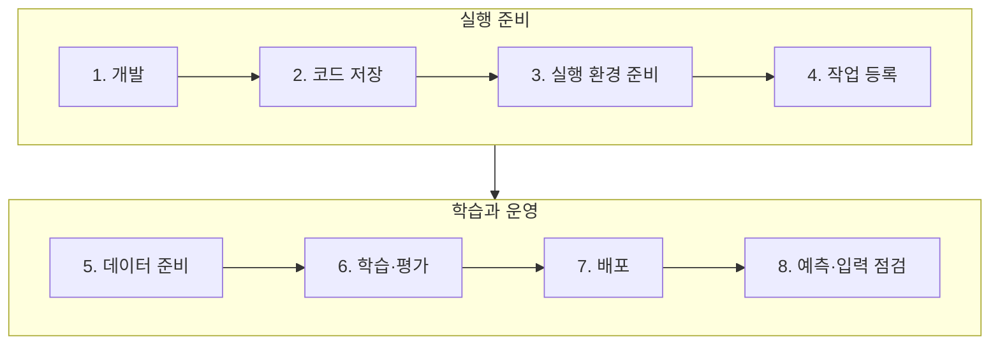

## 1. 개발 {#step-1}

직업·교육 등 8개 값으로 연소득이 5만 달러를 넘는지 분류하는 예제다.
JupyterLab에서 데이터를 살펴보고 세 모델을 학습했다. 노트북에서 확인한 전처리·학습·평가 코드는 Python 파일로 옮겼다.

## 2. 코드 저장 {#step-2}

학습 코드와 예측 API, 실행 설정은 Gitea 저장소 하나에 모았다.

<figure class="lab-shot" markdown="span">

[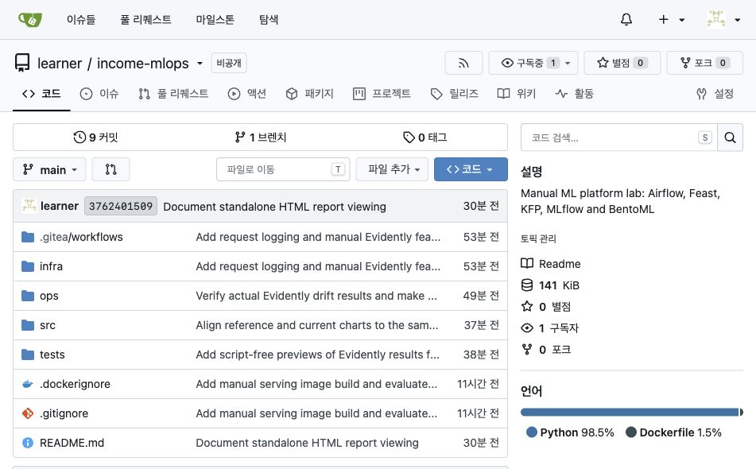](assets/model-serving-monitoring/gitea-source-files.jpg)

<figcaption>Gitea 저장소의 폴더 구성.</figcaption>
</figure>

| 폴더 | 저장한 것 |
|---|---|
| `src/` | 데이터 준비·학습·평가·분포 분석 Python 코드 |
| `infra/` | Airflow DAG, Kubeflow 파이프라인, BentoML API, Dockerfile |
| `ops/` | 이미지 빌드, Pod 교체, 배포 후 검사 코드 |
| `tests/` | 데이터·API·배포 코드의 테스트 |
| `.gitea/workflows/` | Actions에서 어떤 순서로 빌드하고 배포할지 적은 YAML |

**코드는 Git 저장소, 컨테이너 이미지는 Gitea 레지스트리, 데이터와 모델 파일은 SeaweedFS에 저장했다.**

## 3. 실행 환경 준비 {#step-3}

코드와 라이브러리를 컨테이너 이미지로 묶어, 기존 Azure VM의 kind 클러스터에서 실행했다.

| 대상 | 이번 실습의 준비 방식 |
|---|---|
| 데이터 준비·학습 코드 | VM에서 빌드 명령 실행 후 kind 노드에 이미지 반영 |
| 예측 API·입력 분석 코드 | Gitea의 **Build images (manual)** 실행 → 이미지 레지스트리에 저장 |

<figure class="lab-shot" markdown="span">

[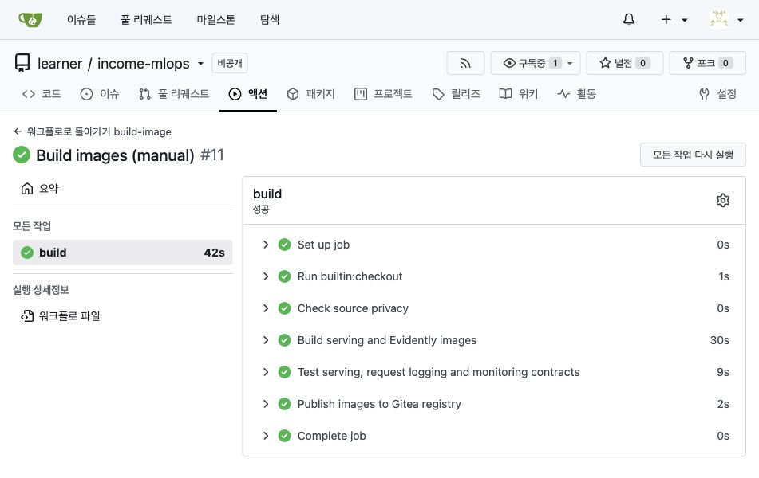](assets/model-serving-monitoring/gitea-image-build.jpg)

<figcaption>빌드 #11. 코드 검사, 이미지 빌드, 테스트와 레지스트리 업로드까지 성공했다.</figcaption>
</figure>

## 4. 작업 등록 {#step-4}

작업 순서와 다음 작업에 전달할 데이터를 코드로 정의했다.

- 데이터 준비: Airflow에 DAG 파일 반영.
- 학습·평가: Kubeflow SDK 코드를 YAML로 컴파일해 등록.

각 작업은 3단계에서 만든 이미지의 코드를 실행한다. 학습 코드를 수정하면 이미지를 다시 빌드하고, 변경 내용에 맞춰 파이프라인도 갱신했다.

## 5. 데이터 준비 {#step-5}

데이터 준비는 별도 Airflow DAG로 분리했다.
원본을 검사해 SeaweedFS에 버전별로 저장하고, Feast에 파일 위치와 피처 정의를 등록했다.

<figure class="lab-shot" markdown="span">

[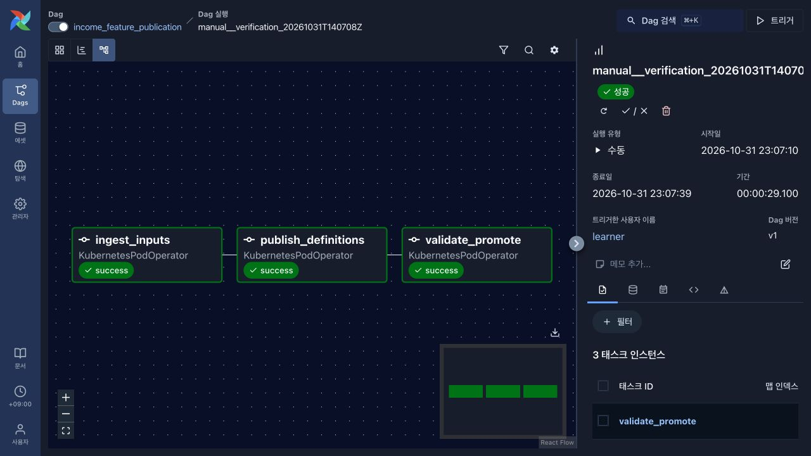](assets/model-serving-monitoring/airflow-data-preparation.jpg)

<figcaption>데이터 준비 DAG. 세 작업이 순서대로 실행돼 모두 성공했다.</figcaption>
</figure>

| 작업 | 하는 일 |
|---|---|
| `ingest_inputs` | 원본을 읽고, 파일이 바뀌었는지와 필요한 열이 있는지 확인 |
| `publish_definitions` | 데이터를 버전별로 저장하고 Feast에 파일 위치와 피처 정의 등록 |
| `validate_promote` | Feast로 실제 읽어 본 뒤 사용할 버전을 확정하고 MLflow에 기록 |

마지막 작업의 로그에서 **`manifest_uri`를 복사해 Kubeflow의 같은 이름 입력칸에 넣었다.**
데이터 버전을 넘기기 위해 직접 만든 JSON 파일의 주소다. 사용할 데이터 파일과 Feast 정의가 들어 있다.

## 6. 학습·평가 {#step-6}

Kubeflow는 전달받은 버전의 피처를 Feast로 조회한 뒤 학습과 평가를 실행했다.

| 작업 | 입력 → 결과 |
|---|---|
| 피처 준비 | 버전 manifest → Feast 조회·정답 결합·데이터 분할 |
| 세 모델 학습 | 학습 데이터 → Decision Tree·Random Forest·XGBoost |
| 평가·비교 | 검증 F1 비교 → 모델 선택 → 선택 모델만 테스트 평가 |

<figure class="lab-shot" markdown="span">

[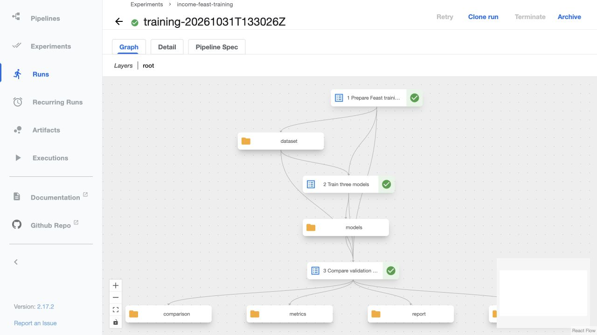](assets/model-serving-monitoring/kubeflow-training-completed.jpg)

<figcaption>학습 파이프라인. dataset과 models는 각 작업이 다음 작업에 넘기는 산출물이다.</figcaption>
</figure>

첫 글에서는 학습·테스트를 80:20으로 나누고 테스트 점수로 모델까지 비교했다.
이번에는 학습 데이터에서 검증셋을 따로 떼어 모델 선택에 사용했다. 기존 테스트 행은 유지하고, 선택한 모델만 테스트했다. 비율은 약 **학습 64% / 검증 16% / 테스트 20%**다.

MLflow에는 모델별 설정과 점수, 비교 결과, 선택한 모델 ID와 데이터 버전을 기록했다. 모델 파일은 SeaweedFS에 저장했다.

배포할 모델을 지정할 때는 **`compare-and-select`의 Run ID**를 사용했다. 이 실행 기록에 세 모델의 비교 결과와 선택한 모델이 들어 있다.

<figure class="lab-shot" markdown="span">

[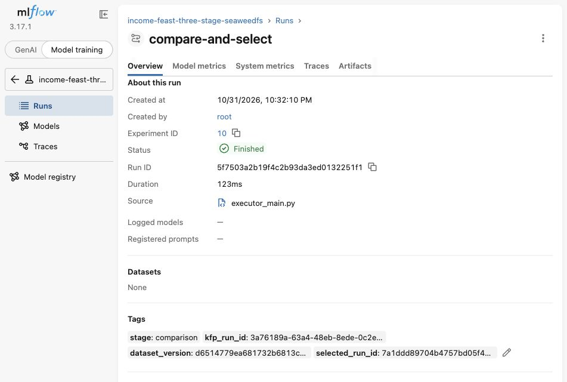](assets/model-serving-monitoring/mlflow-model-selection.jpg)

<figcaption>MLflow의 compare-and-select 기록. 가운데 Run ID가 배포 입력값이다.</figcaption>
</figure>

## 7. 배포 {#step-7}

Gitea의 **Deploy model (manual)**에 이미지 태그와 비교 Run ID를 넣었다. Actions는 비교 기록에서 선택한 모델을 찾아 BentoML Pod를 교체했다.

| 입력칸 | 넣는 값 |
|---|---|
| `image_tag` | 이미지 빌드가 끝난 로그에 나오는 `git-...` 태그 |
| `comparison_run_id` | 앞에서 세 모델을 비교한 MLflow Run ID |

<figure class="lab-shot" markdown="span">

[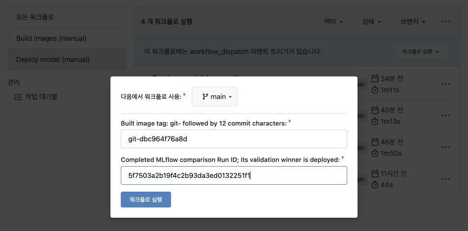](assets/model-serving-monitoring/gitea-deployment-inputs.jpg)

<figcaption>배포 #12에서 사용한 이미지 태그와 비교 Run ID를 다시 입력한 화면.</figcaption>
</figure>

<figure class="lab-shot" markdown="span">

[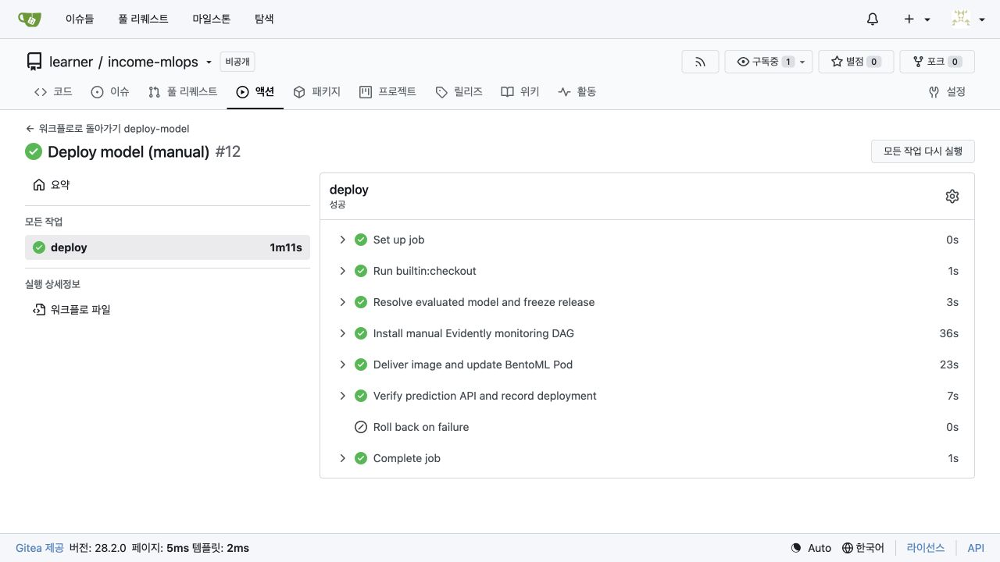](assets/model-serving-monitoring/gitea-deployment-success.jpg)

<figcaption>배포 #12의 실행 기록. Pod 교체 후 예측 API 검사까지 통과했다.</figcaption>
</figure>

```text
서빙 Pod 교체 → 모델 직접 다운로드·해시 확인 → 메모리 로딩 → 시험 예측
```

**Pod가 SeaweedFS에서 모델을 내려받아 메모리에 올리고, 이후 요청에서는 같은 모델을 재사용한다.**
문자열 정리와 원핫 인코더도 함께 저장해 학습 때와 같은 전처리를 적용했다. API는 사용자 ID 대신 8개 피처값을 직접 받도록 했다.

배포 후 시험 요청을 보내 학습 때의 참조 예측과 일치하는지 검사했다. 배포 이력은 MLflow에 기록해 어떤 데이터로 학습한 모델이 서비스 중인지 추적할 수 있게 했다.

## 8. 예측·입력 점검 {#step-8}

### 예측 요청

BentoML의 `/predict`에서 **Try it out**을 눌러 8개 값을 JSON으로 입력했다.
요청을 구분할 `collection_id`에는 `blog-demo`를 넣고 **Execute**로 예측을 요청했다.

<figure class="lab-shot" markdown="span">

[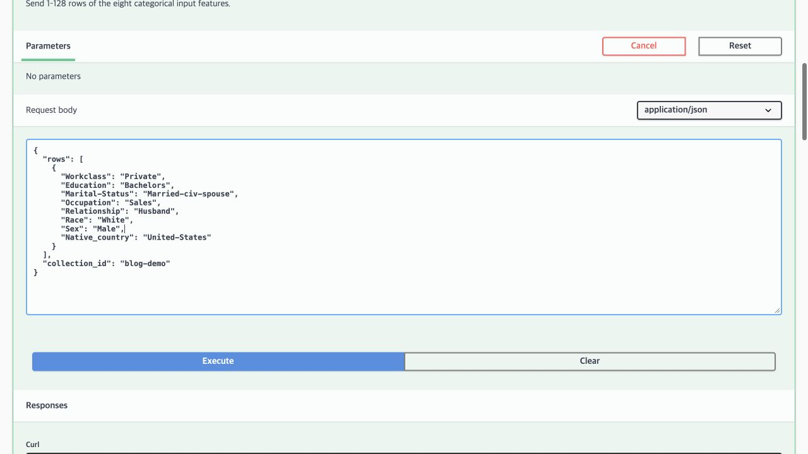](assets/model-serving-monitoring/bentoml-request.jpg)

<figcaption>/predict에 보낸 입력. collection_id는 나중에 분석할 요청들을 묶는 이름이다.</figcaption>
</figure>

<figure class="lab-shot" markdown="span">

[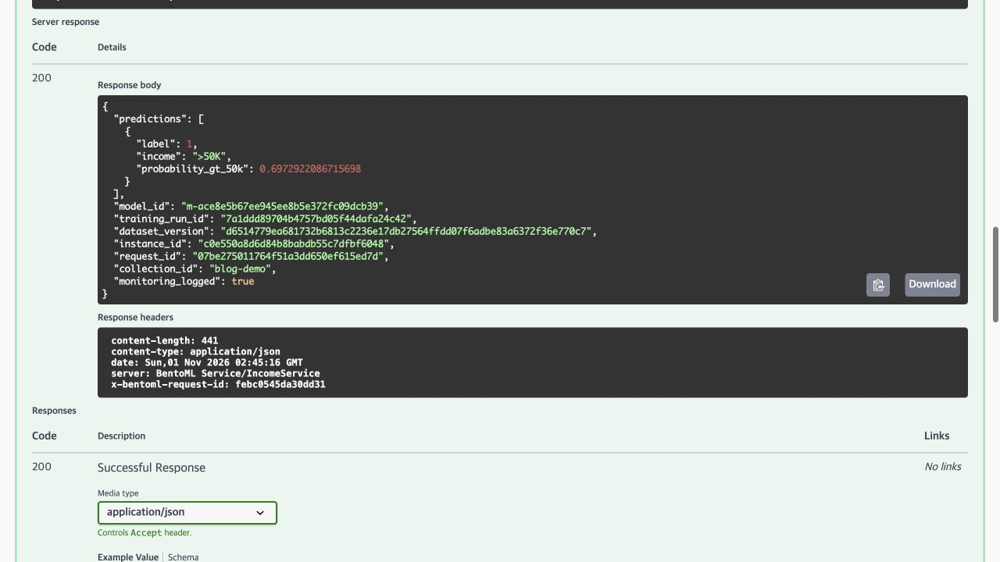](assets/model-serving-monitoring/bentoml-response.jpg)

<figcaption>예측 응답. 소득 구간과 함께 모델 ID와 요청 기록 여부를 반환했다.</figcaption>
</figure>

- **`200`**: API 호출 성공. 예측의 정답 여부와는 별개다.
- **`income: ">50K"`**: 모델이 예측한 소득 구간이다.
- **`model_id`, `training_run_id`**: MLflow에서 모델과 학습 기록을 찾을 때 쓰는 ID다.
- **`monitoring_logged: true`**: 요청과 예측 결과를 SeaweedFS에 저장했다는 뜻이다.

### 입력 변화 확인

저장한 요청은 Evidently로 분석했다. Airflow에서 분석 DAG를 실행하면 해당 모델의 학습 데이터와 요청 데이터를 비교하고, 보고서를 MLflow에 남긴다.

```text
BentoML 요청·예측 기록 → SeaweedFS → Airflow에서 Evidently 실행 → MLflow 지표·보고서
```

| 비교 대상 | 이번 설정 |
|---|---|
| 기준 데이터 | 배포 모델을 학습한 Run의 학습 데이터 19,303행 |
| 현재 데이터 | 해당 모델·요청 묶음의 최근 최대 1,000행 또는 지정한 배치 파일 |
| 분석 범위 | 입력 8개 피처의 분포와 결측값 |
| 표본이 적을 때 | 200행 미만이면 분석 건너뜀 |

### 점검 결과

분포 비교에는 공개 데이터로 만든 모의 입력을 1,000건씩 사용했다.

| 사례 | 만든 입력 | 분석 결과 |
|---|---|---|
| 정상 분포 | 기준 데이터에서 표본 추출 | 드리프트 0 / 8개 |
| 분포 변화 | 직업·교육 등 6개 피처의 구성을 의도적으로 변경 | 드리프트 6 / 8개 |
| 결측값 | 직업 값 600개를 비운 별도 배치 | 직업 결측률 60% 확인 |

API는 누락·빈값을 거절하므로, 결측값 사례는 **별도 배치 파일**로 분석했다. 이 배치는 드리프트 0개로 나왔지만, 직업 값이 60% 비어 있다는 문제는 별도로 확인됐다.

<figure class="lab-shot" markdown="span">

[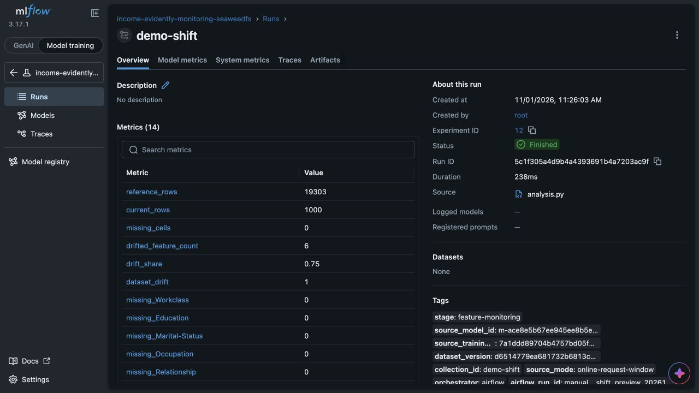](assets/model-serving-monitoring/mlflow-drift-summary.jpg)

<figcaption>MLflow에 남긴 분석 결과. 8개 피처 중 6개의 분포 변화가 감지됐다.</figcaption>
</figure>

보고서와 함께 비교에 쓴 데이터와 파일 해시도 보관했다. 판정 기준은 범주형 Jensen–Shannon 거리 0.1, 변화가 감지된 피처 비율 0.5로 설정했다.

<figure class="lab-shot" markdown="span">

[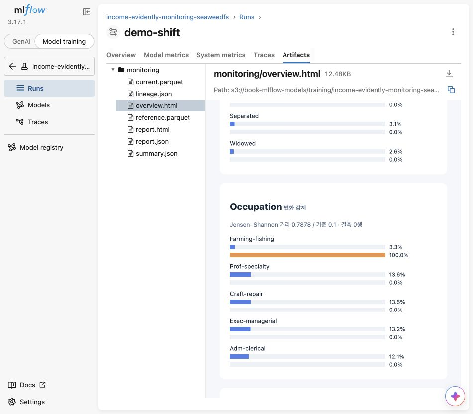](assets/model-serving-monitoring/evidently-distribution-report.jpg)

<figcaption>직업 분포 비교. 파랑은 학습 데이터, 주황은 모의 요청이다.</figcaption>
</figure>

MLflow의 **Artifacts → monitoring → overview.html**에서 연 차트다. Farming-fishing 비율은 학습 데이터에서 약 3.3%였고, 이 모의 요청에서는 차이를 만들기 위해 100%로 바꿨다.

분포가 달라졌다는 결과만으로 예측이 틀렸다고 볼 수는 없다. 정확도와 F1은 정답 데이터를 붙여 확인해야 한다.

## 막혔던 부분

| 문제 | 처리 |
|---|---|
| 학습과 API의 입력 처리 차이 | 전처리와 모델을 함께 저장하고 배포 후 참조 예측과 비교 |
| 온라인 요청이 아직 적음 | 최소 표본 수 미만이면 실패 대신 분석을 건너뜀 |
| 앱 내 브라우저에서 HTML 미리보기가 빈 화면 | Chrome에서 열거나, HTML을 다운로드해서 확인 |

학습한 모델을 API로 배포하고, 들어온 입력을 다시 분석하는 데까지 연결했다. 다음에는 예측에 정답을 붙여 어떤 경우에 틀리는지 확인하고, 그 결과를 다음 학습에 반영해 보려 한다.
