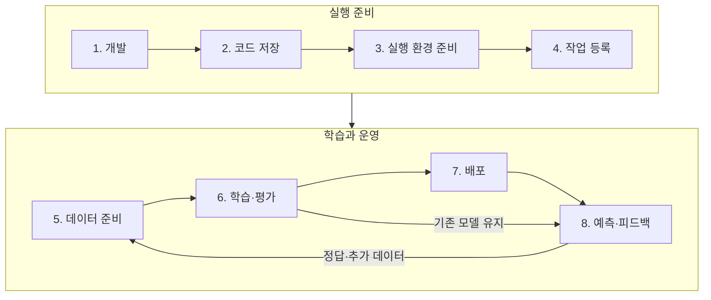
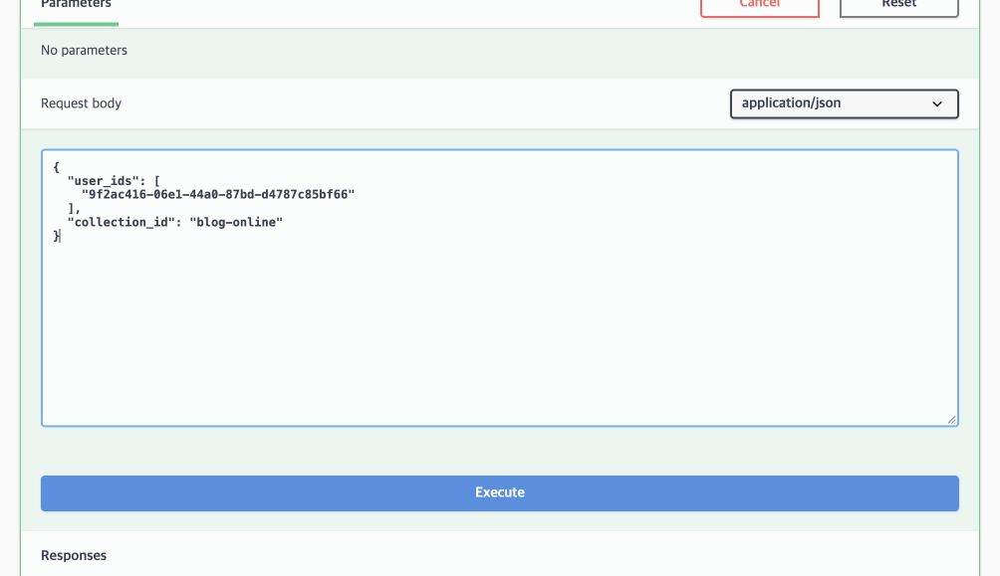
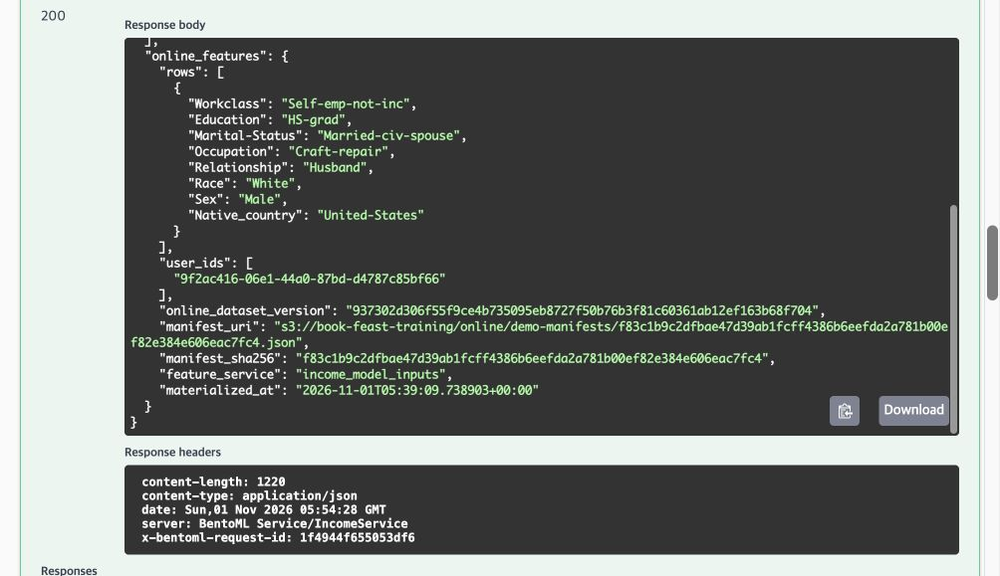
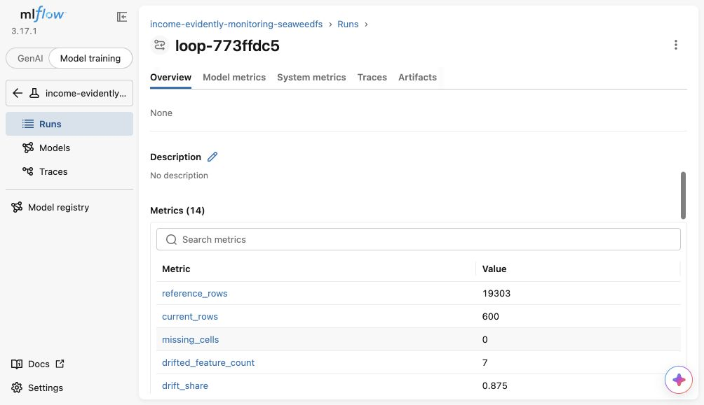
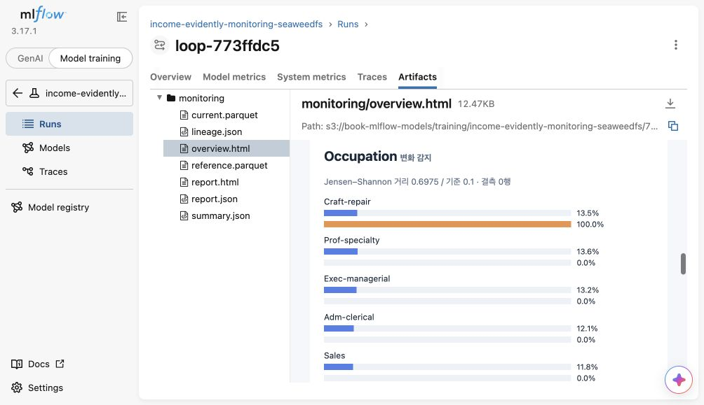
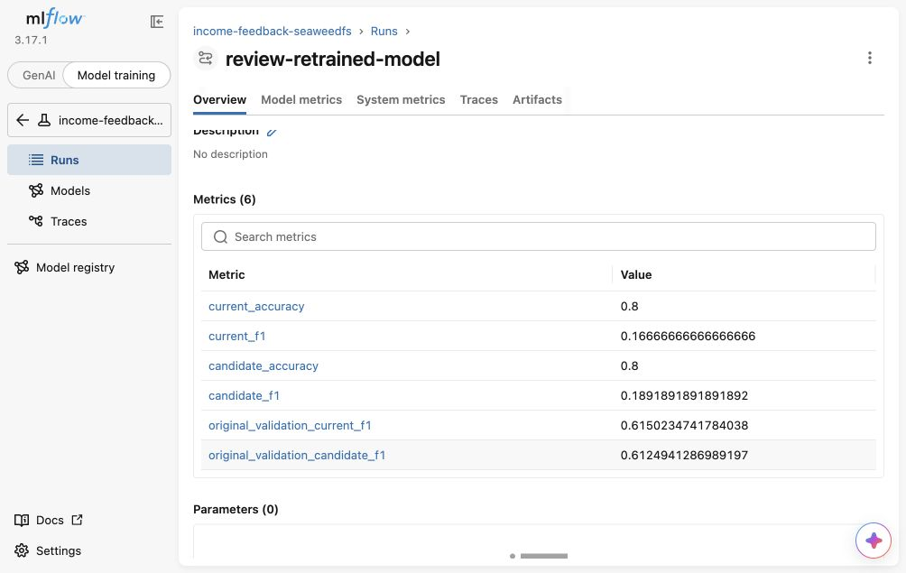

지난 [첫 번째 실습](azure-mlops-lab.md)에서는 소득 분류 모델을 학습하고, 저장한 모델로 배치 추론을 실행했다.
이번에는 사용자 ID로 예측하는 API를 만들었다. 공개 데이터로 모의 요청을 보내고, 정답을 붙여 재학습한 뒤 기존 모델과 비교했다.

## 개발부터 운영까지

| 단계 | 하는 일 | 결과 |
|---|---|---|
| [1. 개발](#step-1) | 데이터 탐색, 전처리·학습·평가·예측 코드 작성 | 실행 코드 |
| [2. 코드 저장](#step-2) | 코드·설정·테스트의 변경 내용 저장 | 코드 버전 |
| [3. 실행 환경 준비](#step-3) | 작성한 코드와 필요한 라이브러리의 이미지 빌드 | 실행 이미지 |
| [4. 작업 등록](#step-4) | 반복 실행할 작업의 순서·입출력 등록 | 등록된 실행 절차 |
| [5. 데이터 준비](#step-5) | 원본 검사·정리, 학습에 사용할 데이터 버전 확정 | 학습 데이터 |
| [6. 학습·평가](#step-6) | 후보 모델 학습, 검증 점수 비교, 선택 모델 테스트 | 선택한 모델·평가 결과 |
| [7. 배포](#step-7) | 코드·모델 버전 선택, 배포 실행, 예측 호출 확인 | 예측 API |
| [8. 예측·피드백](#step-8) | ID로 예측, 입력 분석·정답 수집, 재학습·모델 비교 | 교체 또는 유지 결정 |

## 전체 흐름



## 1. 개발 {#step-1}

직업·교육 등 8개 값으로 연소득이 5만 달러를 넘는지 분류하는 예제다.
JupyterLab에서 데이터를 살펴보고 세 모델을 학습했다. 노트북에서 확인한 전처리·학습·평가 코드는 Python 파일로 옮겼다.

## 2. 코드 저장 {#step-2}

학습 코드와 예측 API, 실행 설정은 Gitea 저장소 하나에 모았다.

<figure class="lab-shot" markdown="span">

[](assets/model-serving-monitoring/gitea-source-files.jpg)

<figcaption>Gitea 저장소의 폴더 구성.</figcaption>
</figure>

| 폴더 | 저장한 것 |
|---|---|
| `src/` | 데이터 준비·학습·평가·분포 분석 Python 코드 |
| `infra/` | Airflow DAG, Kubeflow 파이프라인, BentoML API, Dockerfile |
| `ops/` | 이미지 빌드, Pod 교체, 배포 후 검사 코드 |
| `tests/` | 데이터·API·배포 코드의 테스트 |
| `.gitea/workflows/` | Actions에서 어떤 순서로 빌드하고 배포할지 적은 YAML |

**코드는 Git 저장소, 컨테이너 이미지는 Gitea 레지스트리, 데이터와 모델 파일은 SeaweedFS에 저장했다.**

## 3. 실행 환경 준비 {#step-3}

코드와 라이브러리를 컨테이너 이미지로 묶어, 기존 Azure VM의 kind 클러스터에서 실행했다.

| 대상 | 이번 실습의 준비 방식 |
|---|---|
| 데이터 준비·학습 코드 | VM에서 빌드 명령 실행 후 kind 노드에 이미지 반영 |
| 예측 API·입력 분석·온라인 조회 코드 | Gitea의 **Build images (manual)** 실행 → 이미지 레지스트리에 저장 |

<figure class="lab-shot" markdown="span">

[](assets/model-serving-monitoring/gitea-image-build.jpg)

<figcaption>초기 빌드 #11. 코드 검사부터 레지스트리 업로드까지 통과했다. 온라인 조회 기능을 추가한 뒤에도 같은 절차로 이미지를 다시 빌드했다.</figcaption>
</figure>

## 4. 작업 등록 {#step-4}

작업 순서와 다음 작업에 전달할 데이터를 코드로 정의했다.

- 데이터 준비: Airflow에 DAG 파일 반영.
- 학습·평가: Kubeflow SDK 코드를 YAML로 컴파일해 등록.

각 작업은 3단계에서 만든 이미지의 코드를 실행한다. 학습 코드를 수정하면 이미지를 다시 빌드하고, 변경 내용에 맞춰 파이프라인도 갱신했다.

## 5. 데이터 준비 {#step-5}

데이터 준비는 별도 Airflow DAG로 분리했다.
원본을 검사해 SeaweedFS에 버전별로 저장하고, Feast에 파일 위치와 피처 정의를 등록했다.

<figure class="lab-shot" markdown="span">

[](assets/model-serving-monitoring/airflow-data-preparation.jpg)

<figcaption>데이터 준비 DAG. 세 작업이 순서대로 실행돼 모두 성공했다.</figcaption>
</figure>

| 작업 | 하는 일 |
|---|---|
| `ingest_inputs` | 원본을 읽고, 파일이 바뀌었는지와 필요한 열이 있는지 확인 |
| `publish_definitions` | 데이터를 버전별로 저장하고 Feast에 파일 위치와 피처 정의 등록 |
| `validate_promote` | Feast로 실제 읽어 본 뒤 사용할 버전을 확정하고 MLflow에 기록 |

마지막 작업의 로그에서 **`manifest_uri`를 복사해 Kubeflow의 같은 이름 입력칸에 넣었다.**
데이터 버전을 넘기기 위해 직접 만든 JSON 파일의 주소다. 사용할 데이터 파일과 Feast 정의가 들어 있다.

## 6. 학습·평가 {#step-6}

Kubeflow는 전달받은 버전의 피처를 Feast로 조회한 뒤 학습과 평가를 실행했다.

| 작업 | 입력 → 결과 |
|---|---|
| 피처 준비 | 버전 manifest → Feast 조회·정답 결합·데이터 분할 |
| 세 모델 학습 | 학습 데이터 → Decision Tree·Random Forest·XGBoost |
| 평가·비교 | 검증 F1 비교 → 모델 선택 → 선택 모델만 테스트 평가 |

<figure class="lab-shot" markdown="span">

[](assets/model-serving-monitoring/kubeflow-training-completed.jpg)

<figcaption>학습 파이프라인. dataset과 models는 각 작업이 다음 작업에 넘기는 산출물이다.</figcaption>
</figure>

첫 글에서는 학습·테스트를 80:20으로 나누고 테스트 점수로 모델까지 비교했다.
초기 학습에서는 검증셋을 따로 떼어 모델 선택에 사용했다. 기존 테스트 행은 유지하고, 선택한 모델만 테스트했다. 비율은 약 **학습 64% / 검증 16% / 테스트 20%**다.

MLflow에는 모델별 설정과 점수, 비교 결과, 선택한 모델 ID와 데이터 버전을 기록했다. 모델 파일은 SeaweedFS에 저장했다.

배포할 모델을 지정할 때는 **`compare-and-select`의 Run ID**를 사용했다. 이 실행 기록에 세 모델의 비교 결과와 선택한 모델이 들어 있다.

<figure class="lab-shot" markdown="span">

[](assets/model-serving-monitoring/mlflow-model-selection.jpg)

<figcaption>MLflow의 compare-and-select 기록. 가운데 Run ID가 배포 입력값이다.</figcaption>
</figure>

## 7. 배포 {#step-7}

Gitea의 **Deploy model (manual)**에 이미지 태그와 비교 Run ID를 넣었다. Actions는 비교 기록에서 선택한 모델을 찾아 BentoML Pod를 교체했다.

| 입력칸 | 넣는 값 |
|---|---|
| `image_tag` | 이미지 빌드가 끝난 로그에 나오는 `git-...` 태그 |
| `comparison_run_id` | 앞에서 세 모델을 비교한 MLflow Run ID |

<figure class="lab-shot" markdown="span">

[](assets/model-serving-monitoring/gitea-deployment-inputs.jpg)

<figcaption>배포 #12에서 사용한 이미지 태그와 비교 Run ID를 다시 입력한 화면.</figcaption>
</figure>

<figure class="lab-shot" markdown="span">

[](assets/model-serving-monitoring/gitea-deployment-success.jpg)

<figcaption>배포 #12의 실행 기록. Pod 교체 후 예측 API 검사까지 통과했다.</figcaption>
</figure>

```text
서빙 Pod 교체 → 모델 직접 다운로드·해시 확인 → 메모리 로딩 → 시험 예측
```

**Pod가 SeaweedFS에서 모델을 내려받아 메모리에 올리고, 이후 요청에서는 같은 모델을 재사용한다.**
문자열 정리와 원핫 인코더도 함께 저장해 학습 때와 같은 전처리를 적용했다. 처음 만든 `/predict`는 피처값 8개를 직접 받고, 이후 추가한 `/predict_by_id`는 ID로 피처를 조회한다.

배포 후 시험 요청을 보내 학습 때의 참조 예측과 일치하는지 검사했다. 배포 이력은 MLflow에 기록해 어떤 데이터로 학습한 모델이 서비스 중인지 추적할 수 있게 했다.

## 8. 예측·피드백 {#step-8}

### ID만 보내 예측하기

Airflow의 **income_online_publication**으로 피처 스냅샷을 Redis에 적재했다.
BentoML에 사용자 ID를 보내면 Feast 조회 서버가 그 사용자의 최신 적재값 8개를 읽고, BentoML이 모델에 넣어 예측한다.

```text
사용자 ID → BentoML → Feast·Redis 조회 → 모델 예측
```

`/predict_by_id`에 넣은 값은 ID와 요청 묶음 이름뿐이다. 실습용으로 만든 가상 사용자 ID다.

```json
{
  "user_ids": ["9f2ac416-06e1-44a0-87bd-d4787c85bf66"],
  "collection_id": "blog-online"
}
```

<figure class="lab-shot" markdown="span">

[](assets/model-serving-monitoring/bentoml-id-request.jpg)

<figcaption>ID로 예측 요청. 직업·학력 등 피처값은 요청에 넣지 않았다.</figcaption>
</figure>

<figure class="lab-shot" markdown="span">

[](assets/model-serving-monitoring/bentoml-id-response.jpg)

<figcaption>응답의 online_features에는 모델에 넣은 실제 피처값과 조회한 스냅샷 버전이 들어 있다.</figcaption>
</figure>

모델은 그대로 두고, 같은 ID의 직업·학력 등 여러 피처를 갱신한 뒤 다시 요청했다.

| 확인한 값 | 갱신 전 | 갱신 후 |
|---|---|---|
| 직업 | Adm-clerical | Craft-repair |
| 학력 | Bachelors | HS-grad |
| 연소득 >50K 예측 확률 | 6.1% | 25.3% |

모델의 학습 데이터 버전과 온라인 피처 버전은 따로 기록했다. 새 피처를 적재한 것만으로 모델이 재학습되지는 않는다.
없는 ID는 오류로 반환했고, 성공한 요청은 `request_id`와 함께 SeaweedFS에 저장했다.

### 모인 요청의 분포 확인

[UCI Adult](https://archive.ics.uci.edu/dataset/2/adult)의 `adult.test`에서 Craft-repair 직업군의 관측값을 골라 가상 사용자 600명에게 배정했다.
기존 학습 데이터보다 특정 직업군의 요청이 많아진 상황을 흉내 냈다.

Airflow의 **income_model_monitoring**으로 이 요청들을 분석했다.

| 비교·분석 항목 | 결과 |
|---|---:|
| 기준: 배포 모델의 학습 데이터 | 19,303행 |
| 비교: ID로 예측한 요청 | 600행 |
| 분포 변화 감지 | 8개 중 7개 피처 |
| 결측값 | 0개 |

<figure class="lab-shot" markdown="span">

[](assets/model-serving-monitoring/mlflow-online-drift.jpg)

<figcaption>요청 600건의 분석 기록. drifted_feature_count는 7, drift_share는 0.875다.</figcaption>
</figure>

<figure class="lab-shot" markdown="span">

[](assets/model-serving-monitoring/evidently-online-distribution.jpg)

<figcaption>Evidently 결과로 만든 정적 요약. 파랑은 학습 데이터, 주황은 이번 요청이다. Craft-repair 비율이 13.5% → 100%로 달라졌다.</figcaption>
</figure>

보고서와 비교 데이터, 원본 파일 해시를 함께 보관했다. 분포 판정 기준은 범주형 Jensen–Shannon 거리 0.1, 변화가 감지된 피처 비율 0.5로 설정했다.

### 정답을 붙여 다시 학습하기

분포가 달라졌다는 것만으로 예측 성능을 알 수는 없다. 공개 데이터에 이미 있는 정답을 별도로 전달해, 예측 후 정답을 확보하는 상황을 흉내 냈다.
**요청 당시 저장한 피처에 `request_id`와 행 위치로 정답을 붙였다.**

| 실행 순서 | 한 일 | 결과 |
|---|---|---|
| Airflow · 피드백 준비 | 요청·정답 결합, 현재 예측 평가, 300명씩 분리 | 학습용 300명·비교용 300명 |
| Airflow · 데이터 게시 | 학습용 300명만 기존 데이터에 추가 | 새 Feast 학습 스냅샷 |
| Kubeflow · 재학습 | 같은 검증셋으로 세 모델 비교 | XGBoost 선택 |
| Airflow · 모델 재검토 | 남겨둔 300명에 기존·새 모델로 예측 | 같은 입력에 대한 점수 비교 |

학습 행은 **19,303 → 19,603**으로 늘었다. 기존 검증 4,826행·테스트 6,033행은 그대로 유지했고, 비교용 300명도 학습에서 제외했다.

### 재학습 전후 비교

| 평가 데이터 · F1 | 기존 모델 | 재학습 모델 |
|---|---:|---:|
| 학습에서 제외한 새 사용자 300명 | 0.167 | 0.189 |
| 기존 검증셋 4,826행 | 0.615 | 0.612 |

<figure class="lab-shot" markdown="span">

[](assets/model-serving-monitoring/mlflow-feedback-comparison.jpg)

<figcaption>current는 기존 모델, candidate는 재학습 모델이다. original_validation은 기존 검증셋 점수다.</figcaption>
</figure>

새 사용자에서는 F1이 조금 올랐지만 기존 검증셋에서는 내려갔다. **이번에는 서비스 모델을 유지했다.**
MLflow에 `promotion_decision=keep_current`와 이유를 남기고, 유지한 모델로 다시 ID 예측을 보내 요청 저장까지 확인했다.

## 막혔던 부분

| 문제 | 처리 |
|---|---|
| 학습과 API의 입력 처리 차이 | 전처리와 모델을 함께 저장하고 배포 후 참조 예측과 비교 |
| Feast와 서빙 라이브러리의 버전 차이 | Feast 조회 서버를 분리하고 BentoML과 HTTP로 연결 |
| 온라인 요청이 아직 적음 | 최소 표본 수 미만이면 실패 대신 분석을 건너뜀 |
| 앱 내 브라우저에서 HTML 미리보기가 빈 화면 | Chrome에서 열거나, HTML을 다운로드해서 확인 |

이번에는 예측 결과를 다음 학습에 반영하고, 기존 모델을 유지하는 결정까지 기록했다. 다음 실험에서는 틀린 사례를 살펴보고 피처와 데이터 구성을 보완해, 두 평가에서 함께 개선되는지 확인하려 한다.
