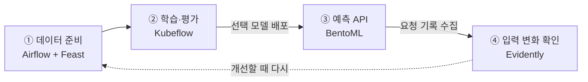

지난 [첫 번째 실습](azure-mlops-lab.md)에서는 소득 분류 모델을 학습하고, 저장한 모델로 배치 추론을 실행했다.
이번에는 **데이터 준비와 학습을 분리하고, 선택한 모델을 API로 배포한 뒤 입력 데이터의 변화까지 확인**했다.

## 전체 흐름



화살표는 업무의 순서다. **현재는 단계마다 사람이 결과를 확인하고 다음 작업을 수동 실행한다.**

| 흐름을 받치는 도구 | 역할 |
|---|---|
| JupyterLab | 데이터를 살펴보고 코드를 개발하는 작업 공간 |
| SeaweedFS | 데이터·모델·산출물의 실제 파일을 보관하는 창고 |
| MLflow | 설정·점수·데이터 버전·모델의 연결을 남기는 실험 일지 |
| Gitea + Actions | 코드 보관, 컨테이너 이미지 빌드와 배포 |

실행 환경은 기존 Azure VM과 kind Kubernetes를 계속 사용했다.

## ① 데이터 준비: Airflow와 Feast

처음에는 학습 코드에 CSV 읽기와 Feast 등록·조회가 섞여 있었다.
데이터가 바뀔 때마다 다시 준비할 수 있도록 **피처 게시 작업을 별도 Airflow DAG로 분리**했다.

```text
원본 검증 → 버전별 피처 파일·Feast 정의 게시 → 조회 검증·버전 확정
```

| 순서 | 실제로 하는 일 |
|---|---|
| 원본 검증 | SeaweedFS에서 원본을 읽고 해시·스키마 확인 |
| 피처 게시 | 버전별 데이터 스냅샷과 Feast registry 저장 |
| 버전 확정 | Feast로 전체 조회가 되는지 확인하고 MLflow에 기록 |

이 DAG가 돌려주는 `manifest_uri`를 다음 Kubeflow 실행에 입력한다.
**SeaweedFS에 저장한 JSON 파일의 주소**이며, 사용할 데이터와 Feast 정의·파일 해시를 묶어 설명한다.
이 manifest는 실습에서 만든 연결 규약이다. Feast 자체가 모든 원본 데이터의 버전을 자동 관리하는 것은 아니다.

Airflow와 Kubeflow는 모두 작업을 연결하고 실행한다. 이번에는 두 도구를 익히면서,
데이터 게시와 모델 학습을 독립적으로 실행하기 위해 역할을 나눴다.

## ② 학습·평가: Kubeflow와 MLflow

학습 파이프라인은 세 Task로 정리했다. **Feast 등록은 앞 단계에서 끝나고, 여기서는 선택한 버전을 조회한다.**

| Task | 입력 → 결과 |
|---|---|
| 피처 준비 | 버전 manifest → Feast 조회·정답 결합·데이터 분할 |
| 세 모델 학습 | 학습 데이터 → Decision Tree·Random Forest·XGBoost |
| 평가·비교 | 검증 F1 비교 → 모델 선택 → 선택 모델만 테스트 평가 |

첫 글에서는 학습·테스트를 80:20으로 나누고 테스트 점수로 모델까지 비교했다.
이번에는 기존 테스트 행을 유지하고 학습 쪽에서 검증 데이터를 분리했다. 비율은 약 **학습 64% / 검증 16% / 테스트 20%**다.

MLflow에는 각 모델의 설정·점수, 비교 결과, 선택한 모델 ID와 데이터 버전을 연결했다.
모델 파일은 SeaweedFS에 저장한다. 이번에 개선한 것은 **선택·평가 절차**이며, 이 변경만으로 예측 성능이 좋아졌다고 결론 내리지는 않았다.

## ③ 배포: Gitea Actions와 BentoML

배치 작업이 끝날 때마다 Pod가 종료되는 방식에서, **모델을 메모리에 올려 두고 요청에 응답하는 API**로 확장했다.
BentoML은 모델 로딩과 예측 코드를 API 서비스로 묶는 데 사용했다.

| 수동 Actions 작업 | 동작 |
|---|---|
| 이미지 빌드 | 소스 검사·테스트 → BentoML·분석 이미지 빌드 → Gitea 레지스트리에 저장 |
| 모델 배포 | 이미지 태그 + 비교 Run ID 지정 → 선택 모델 확인 → 서빙 Pod 갱신·예측 검증 |

**코드를 push하거나 학습을 완료한 것만으로 배포되지는 않는다.** 배포할 비교 Run을 사람이 선택한다.
Git에는 코드와 작업 정의를 저장하고, 데이터·모델 파일·인증값은 넣지 않았다.

```text
Pod 시작: 고정된 S3 경로 → 모델 직접 다운로드·해시 확인 → 메모리에 로딩
요청 처리: 8개 피처값 → 저장된 전처리 + predict() → 예측 결과
```

모델 파일은 MLflow 서버를 중계하지 않고 **Pod가 SeaweedFS에서 직접 다운로드**한다.
학습 때 사용한 문자열 정리와 원핫 인코더도 모델에 함께 저장해 요청마다 재사용한다.
현재 API는 8개 피처값을 직접 받으며, Feast 조회는 학습 데이터 준비에서 사용한다.

검증에서는 같은 worker가 모델을 재사용하는지, 예측이 학습 시 참조 결과와 일치하는지 확인했다.
배포 이력도 MLflow에 남겨 **데이터 버전 → 학습 → 비교·선택 → 배포 모델**을 따라갈 수 있게 했다.

## ④ 관측: Evidently로 무엇을 확인했나

모델을 배포한 다음에는 “요청이 성공했나?” 외에 **“지금 들어오는 데이터가 학습 때와 달라졌나?”**도 확인해야 한다.
Evidently는 Airflow 작업 안에서 학습 기준 데이터와 수집된 입력을 비교하고 보고서를 만든다.

```text
BentoML 요청·예측 기록 → SeaweedFS → Airflow 수동 분석 → MLflow 지표·보고서
```

| 비교 대상 | 이번 설정 |
|---|---|
| 기준 데이터 | 배포 모델을 학습한 Run의 학습 데이터 19,303행 |
| 현재 데이터 | 해당 모델·요청 묶음의 최근 최대 1,000행 또는 지정한 배치 파일 |
| 분석 범위 | 입력 8개 피처의 분포와 결측값 |
| 표본이 적을 때 | 200행 미만이면 분석 건너뜀 |

온라인 추론도 **모인 요청을 묶어서** 분포를 본다. 배치 입력은 준비된 파일을 바로 비교할 수 있다.

### 실제 확인한 결과

운영 트래픽 대신 공개 데이터로 모의 요청을 만들었다. 각 비교 대상은 1,000행이다.

| 사례 | 만든 입력 | 분석 결과 |
|---|---|---|
| 정상 분포 | 기준 데이터에서 표본 추출 | 드리프트 0 / 8개 |
| 분포 변화 | 직업·교육 등 6개 피처의 구성을 의도적으로 변경 | 드리프트 6 / 8개 |
| 결측값 | 직업 값 600개를 비운 별도 배치 | 직업 결측률 60% 확인 |

결측값 사례는 **배치 파일로 분석**했다. 현재 API는 누락·빈값을 거절하므로 이 요청들은 성공 요청 기록에 포함되지 않는다.
결측값 점검과 분포 변화 판정도 따로 봤다. 이번 결측 배치는 드리프트 0개였지만 직업 값의 누락을 확인할 수 있었다.

<figure class="lab-shot" markdown="span">

[](assets/model-serving-monitoring/mlflow-drift-summary.jpg)

<figcaption>MLflow · 변화 감지 피처 6개, 비율 0.75. 모델·학습 Run·데이터 버전도 함께 기록했다.</figcaption>
</figure>

보고서와 비교에 사용한 데이터·파일 해시도 보관했다.
범주형 Jensen–Shannon 거리 0.1, 전체 피처 중 변화 비율 0.5를 판정 기준으로 설정했다. 이는 이 실습의 설정이다.

**드리프트는 오답이나 성능 저하를 뜻하지 않는다.** 정확도·F1은 정답 데이터가 있어야 평가할 수 있다.
이번 분석은 입력의 변화와 누락을 발견해 다음 실험의 근거를 남기는 데 목적을 뒀다.

## 막혔던 부분과 정리

| 문제 | 처리 |
|---|---|
| 학습과 API의 입력 처리 차이 | 전처리와 모델을 함께 저장하고 배포 후 참조 예측과 비교 |
| 온라인 요청이 아직 적음 | 최소 표본 수 미만이면 실패 대신 분석을 건너뜀 |
| HTML 보고서 미리보기가 빈 화면 | MLflow Overview에서 지표 확인, HTML은 다운로드해서 열기 |

이번에는 **데이터 준비 → 학습·평가 → 모델 배포 → 입력 관측**을 한 바퀴 연결했다.
각 도구를 붙이는 것보다 중요한 것은 **어떤 데이터와 모델로 실행했고, 무엇을 보고 다음 실험을 결정할지** 남기는 일이었다.

다음에는 수집된 정답과 오분류 사례를 함께 보고 데이터·피처·학습 설정을 바꿔 비교할 수 있다.
현재는 자동 스케줄·재학습·재배포를 켜지 않았으며, 변경과 다음 실행은 직접 결정한다.
