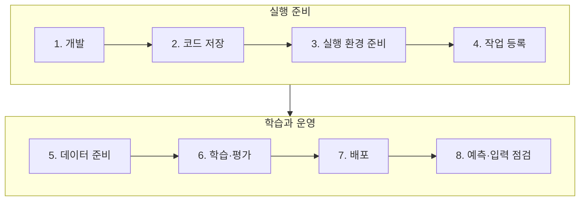

지난 [첫 번째 실습](azure-mlops-lab.md)에서는 소득 분류 모델을 학습하고, 저장한 모델로 배치 추론을 실행했다.
이번에는 학습한 모델을 API로 배포하고, 요청이 쌓인 뒤 입력 데이터가 어떻게 달라지는지 확인했다.
화면 이미지는 누르면 원본 크기로 볼 수 있다.

## 개발부터 운영까지

| 단계 | 하는 일 | 결과 |
|---|---|---|
| [1. 개발](#step-1) | 데이터 탐색, 전처리·학습·평가·예측 코드 작성 | 실행 코드 |
| [2. 코드 저장](#step-2) | 코드·설정·테스트의 변경 내용 저장 | 코드 버전 |
| [3. 실행 환경 준비](#step-3) | 작성한 코드와 필요한 라이브러리의 이미지 빌드 | 실행 이미지 |
| [4. 작업 등록](#step-4) | 반복 실행할 작업의 순서·입출력 등록 | 등록된 실행 절차 |
| [5. 데이터 준비](#step-5) | 원본 검사·정리, 학습에 사용할 데이터 버전 확정 | 학습 데이터 |
| [6. 학습·평가](#step-6) | 후보 모델 학습, 검증 점수 비교, 선택 모델 테스트 | 선택한 모델·평가 결과 |
| [7. 배포](#step-7) | 코드·모델 버전 선택, 배포 실행, 예측 호출 확인 | 예측 API |
| [8. 예측·입력 점검](#step-8) | 예측 요청, 요청 기록 수집, 학습 데이터와의 분포·누락 비교 | 예측 결과·입력 변화 보고서 |

자동 스케줄은 두지 않고, 필요할 때 직접 실행했다.

## 전체 흐름



## 1. 개발 {#step-1}

직업·교육 등 8개 입력으로 소득 구간을 분류하는 모델을 만들었다.
JupyterLab에서 데이터를 살펴보고 학습을 시험한 뒤, 반복할 전처리·학습·평가 코드를 Python 함수로 옮겼다.
예측 API와 요청 기록·분포 분석 코드도 추가했다.

## 2. 코드 저장 {#step-2}

Gitea에는 학습·평가 코드, API, 설정과 테스트를 함께 저장했다.

<figure class="lab-shot" markdown="span">

[](assets/model-serving-monitoring/gitea-source-files.jpg)

<figcaption>학습 코드와 배포 설정을 함께 관리한 저장소.</figcaption>
</figure>

| 폴더 | 저장한 것 |
|---|---|
| `src/` | 데이터 준비·학습·평가·분포 분석 Python 코드 |
| `infra/` | Airflow DAG, Kubeflow 파이프라인, BentoML API, Dockerfile |
| `ops/` | 이미지 빌드, Pod 교체, 배포 후 검사 코드 |
| `tests/` | 데이터·API·배포 코드의 테스트 |
| `.gitea/workflows/` | Actions에서 어떤 순서로 빌드하고 배포할지 적은 YAML |

**코드는 Git 저장소, 컨테이너 이미지는 Gitea 레지스트리, 데이터와 모델 파일은 SeaweedFS에 저장했다.**

## 3. 실행 환경 준비 {#step-3}

실행할 코드와 필요한 라이브러리를 컨테이너 이미지로 묶었다. 기존 Azure VM의 kind 클러스터에서 이 이미지를 실행했다.

| 대상 | 이번 실습의 준비 방식 |
|---|---|
| 데이터 준비·학습 코드 | VM에서 빌드 명령 실행 후 kind 노드에 이미지 반영 |
| 예측 API·입력 분석 코드 | Actions를 직접 시작해 빌드 후 이미지 레지스트리에 저장 |

예측 API·입력 분석 이미지는 Gitea의 **Build images (manual)** 작업을 직접 실행해 만들었다.

<figure class="lab-shot" markdown="span">

[](assets/model-serving-monitoring/gitea-image-build.jpg)

<figcaption>Actions · 빌드 #11. 코드를 검사하고 이미지를 만든 뒤 테스트를 거쳐 레지스트리에 올렸다.</figcaption>
</figure>

## 4. 작업 등록 {#step-4}

실행할 코드와 순서, 주고받을 데이터, 사용할 이미지를 정해 작업을 등록했다.

- 데이터 준비: Airflow에 DAG 파일 반영.
- 학습·평가: Kubeflow SDK 코드를 YAML로 컴파일해 등록.

이 등록은 수동으로 진행했다. 데이터 준비·학습 코드를 수정하면 이미지를 다시 빌드하고 작업 정의도 갱신해야 한다.

## 5. 데이터 준비 {#step-5}

원본을 확인하고 피처 정의를 등록한 뒤, 학습에 쓸 데이터 버전을 정했다.
데이터가 바뀌면 이 작업만 다시 실행할 수 있도록 학습과 분리했다. 준비 작업은 Airflow에서 실행하고, 피처 정의와 조회에는 Feast를 사용했다.

```text
원본 확인 → 데이터 저장·피처 등록 → 조회 확인·버전 확정
```

<figure class="lab-shot" markdown="span">

[](assets/model-serving-monitoring/airflow-data-preparation.jpg)

<figcaption>Airflow · 왼쪽부터 순서대로 실행했고, 상자 세 개가 모두 초록색 success로 끝났다.</figcaption>
</figure>

오른쪽 위 **트리거**로 수동 실행했다. 화면의 상자는 다음 일을 한다.

| 화면의 상자 | 하는 일 |
|---|---|
| `ingest_inputs` | 원본을 읽고, 파일이 바뀌었는지와 필요한 열이 있는지 확인 |
| `publish_definitions` | 데이터를 버전별로 저장하고 Feast에 파일 위치와 피처 정의 등록 |
| `validate_promote` | Feast로 실제 읽어 본 뒤 사용할 버전을 확정하고 MLflow에 기록 |

**다음 학습으로 넘길 값은 마지막 작업이 돌려준 `manifest_uri`다.**
`validate_promote` 상자를 눌러 로그의 `manifest_uri`를 복사하고, Kubeflow의 같은 이름 입력칸에 붙여넣는다.
사용할 데이터 파일과 Feast 정의가 적힌 JSON 파일의 주소다. 이 파일 형식은 실습에서 직접 정했다.

## 6. 학습·평가 {#step-6}

데이터 버전을 정하고 세 모델을 학습했다. 검증 점수로 모델을 고른 뒤 선택한 모델만 테스트했다.
Kubeflow에서는 아래 세 작업으로 나눠 실행했다. **5단계에서 등록한 피처를 여기서 조회한다.**

| 작업 | 입력 → 결과 |
|---|---|
| 피처 준비 | 버전 manifest → Feast 조회·정답 결합·데이터 분할 |
| 세 모델 학습 | 학습 데이터 → Decision Tree·Random Forest·XGBoost |
| 평가·비교 | 검증 F1 비교 → 모델 선택 → 선택 모델만 테스트 평가 |

<figure class="lab-shot" markdown="span">

[](assets/model-serving-monitoring/kubeflow-training-completed.jpg)

<figcaption>Kubeflow · 작업 세 개가 모두 끝났다. dataset은 준비한 데이터, models는 학습한 세 모델이다.</figcaption>
</figure>

첫 글에서는 학습·테스트를 80:20으로 나누고 테스트 점수로 모델까지 비교했다.
이번에는 기존 테스트 행을 유지하고 학습 쪽에서 검증 데이터를 분리했다. 비율은 약 **학습 64% / 검증 16% / 테스트 20%**다.

MLflow에는 각 모델의 설정·점수, 비교 결과, 선택한 모델 ID와 데이터 버전을 연결했다.
모델 파일은 SeaweedFS에 저장했다.

학습이 끝나면 MLflow에서 **`compare-and-select` 실행을 열고 Overview의 Run ID**를 복사한다. 다음 배포에서 이 값을 사용한다.

<figure class="lab-shot" markdown="span">

[](assets/model-serving-monitoring/mlflow-model-selection.jpg)

<figcaption>MLflow · 가운데 Run ID를 복사한다. Gitea의 comparison_run_id 칸에 넣을 값이다.</figcaption>
</figure>

## 7. 배포 {#step-7}

3단계에서 만든 이미지와 6단계에서 고른 모델을 배포했다. 배포 후에는 시험 요청을 보내 예측 응답을 확인했다.

Gitea의 **Deploy model (manual) → 워크플로 실행**을 열고 두 값을 입력한다.

| 입력칸 | 넣는 값 |
|---|---|
| `image_tag` | 이미지 빌드가 끝난 로그에 나오는 `git-...` 태그 |
| `comparison_run_id` | 앞에서 세 모델을 비교한 MLflow Run ID |

<figure class="lab-shot" markdown="span">

[](assets/model-serving-monitoring/gitea-deployment-inputs.jpg)

<figcaption>배포 입력창 · 위 칸은 실행할 코드 이미지, 아래 칸은 배포할 모델을 고르는 값이다.</figcaption>
</figure>

입력 화면에는 **배포 #12**에서 사용한 값을 넣었다. 아래는 그 배포가 끝난 기록이다.

<figure class="lab-shot" markdown="span">

[](assets/model-serving-monitoring/gitea-deployment-success.jpg)

<figcaption>Gitea Actions · 배포 #12. 모델 확인, 서빙 Pod 교체, API 예측 검사까지 성공했다.</figcaption>
</figure>

화면의 **Deliver image and update BentoML Pod**가 서버를 교체하는 단계다.
그다음 **Verify prediction API and record deployment**에서 시험 요청을 보내 예상한 예측이 나오는지 확인했다.
`Roll back on failure`는 실패가 없어 건너뛰었다.

배포는 자동으로 시작하지 않았다. 비교 결과를 확인한 뒤 배포 작업을 직접 실행했다.

```text
서빙 Pod 교체 → 모델 직접 다운로드·해시 확인 → 메모리 로딩 → 시험 예측
```

모델 파일은 MLflow 서버를 중계하지 않고 **Pod가 SeaweedFS에서 직접 다운로드**한다.
학습 때 사용한 문자열 정리와 원핫 인코더도 모델에 함께 저장해 요청마다 재사용한다.
현재 API는 8개 피처값을 직접 받으며, Feast 조회는 학습 데이터 준비에서 사용한다.

검증에서는 같은 worker가 모델을 재사용하는지, 예측이 학습 시 참조 결과와 일치하는지 확인했다.
배포 이력도 MLflow에 남겨 **데이터 버전 → 학습 → 비교·선택 → 배포 모델**을 따라갈 수 있게 했다.

## 8. 예측·입력 점검 {#step-8}

API에 요청을 보내 예측 결과를 받았다. 요청 기록이 모인 뒤에는 학습 때와 입력 분포가 달라졌는지 살펴봤다.

### 예측 요청

BentoML의 `/predict`를 펼치고 **Try it out**을 누른다.
직업·교육 등 8개 값을 JSON에 넣고 **Execute**를 눌렀다.
`collection_id`는 요청을 묶어 구분할 이름이다. 이번 요청에는 `blog-demo`를 넣었다.

<figure class="lab-shot" markdown="span">

[](assets/model-serving-monitoring/bentoml-request.jpg)

<figcaption>BentoML · 입력을 작성한 화면. Execute를 누르면 배포된 모델에 요청이 전달된다.</figcaption>
</figure>

<figure class="lab-shot" markdown="span">

[](assets/model-serving-monitoring/bentoml-response.jpg)

<figcaption>BentoML · 같은 입력에 대한 실제 응답. 이 예시는 소득이 5만 달러를 넘는 구간으로 예측했다.</figcaption>
</figure>

- **`200`**: API 호출이 정상 처리됐다는 뜻이다. 정답을 맞혔다는 뜻은 아니다.
- **`income: ">50K"`**: 모델이 예측한 소득 구간이다.
- **`model_id`, `training_run_id`**: 어떤 모델과 학습에서 나온 예측인지 MLflow에서 찾는 값이다.
- **`monitoring_logged: true`**: 이 요청과 예측을 SeaweedFS에 저장했다. 이렇게 모인 입력을 다음 Evidently 작업에서 비교한다.

### 입력 변화 확인

모아둔 입력이 학습 데이터와 얼마나 다른지 비교했다. Evidently를 Airflow 작업으로 실행해 분포와 결측값을 확인했다.

```text
BentoML 요청·예측 기록 → SeaweedFS → Airflow 수동 분석 → MLflow 지표·보고서
```

| 비교 대상 | 이번 설정 |
|---|---|
| 기준 데이터 | 배포 모델을 학습한 Run의 학습 데이터 19,303행 |
| 현재 데이터 | 해당 모델·요청 묶음의 최근 최대 1,000행 또는 지정한 배치 파일 |
| 분석 범위 | 입력 8개 피처의 분포와 결측값 |
| 표본이 적을 때 | 200행 미만이면 분석 건너뜀 |

온라인 추론도 **모인 요청을 묶어서** 분포를 본다. 배치 입력은 준비된 파일을 바로 비교할 수 있다.

### 점검 결과

분포 비교에는 공개 데이터로 만든 모의 입력을 1,000건씩 사용했다.

| 사례 | 만든 입력 | 분석 결과 |
|---|---|---|
| 정상 분포 | 기준 데이터에서 표본 추출 | 드리프트 0 / 8개 |
| 분포 변화 | 직업·교육 등 6개 피처의 구성을 의도적으로 변경 | 드리프트 6 / 8개 |
| 결측값 | 직업 값 600개를 비운 별도 배치 | 직업 결측률 60% 확인 |

결측값 사례는 **배치 파일로 분석**했다. 현재 API는 누락·빈값을 거절하므로 이 요청들은 성공 요청 기록에 포함되지 않는다.
결측값 점검과 분포 변화 판정도 따로 봤다. 이번 결측 배치는 드리프트 0개였지만 직업 값의 누락을 확인할 수 있었다.

<figure class="lab-shot" markdown="span">

[](assets/model-serving-monitoring/mlflow-drift-summary.jpg)

<figcaption>MLflow · 변화 감지 피처 6개, 비율 0.75. 모델·학습 Run·데이터 버전도 함께 기록했다.</figcaption>
</figure>

보고서와 비교에 사용한 데이터·파일 해시도 보관했다.
범주형 Jensen–Shannon 거리 0.1, 전체 피처 중 변화 비율 0.5를 판정 기준으로 설정했다. 이는 이 실습의 설정이다.

<figure class="lab-shot" markdown="span">

[](assets/model-serving-monitoring/evidently-distribution-report.jpg)

<figcaption>Evidently · 파랑은 학습 데이터, 주황은 모의 요청이다. 이 사례는 직업을 전부 Farming-fishing으로 바꿔 차이를 만들었다.</figcaption>
</figure>

Chrome에서 **Artifacts → monitoring → overview.html**을 열면 위 차트를 볼 수 있다.
예를 들어 Farming-fishing 비율은 학습 데이터에서 약 3.3%, 이 모의 요청에서는 100%다.

분포가 달라졌다는 결과만으로 예측이 틀렸다고 볼 수는 없다. 정확도와 F1은 정답 데이터를 붙여 확인해야 한다.

## 막혔던 부분

| 문제 | 처리 |
|---|---|
| 학습과 API의 입력 처리 차이 | 전처리와 모델을 함께 저장하고 배포 후 참조 예측과 비교 |
| 온라인 요청이 아직 적음 | 최소 표본 수 미만이면 실패 대신 분석을 건너뜀 |
| 앱 내 브라우저에서 HTML 미리보기가 빈 화면 | Chrome에서 열거나, HTML을 다운로드해서 확인 |

여기까지는 API 응답과 입력의 변화를 확인했다.
다음에는 요청에 정답을 붙여 어떤 경우에 틀렸는지 확인하고, 데이터를 추가해 다시 학습할 차례다.
